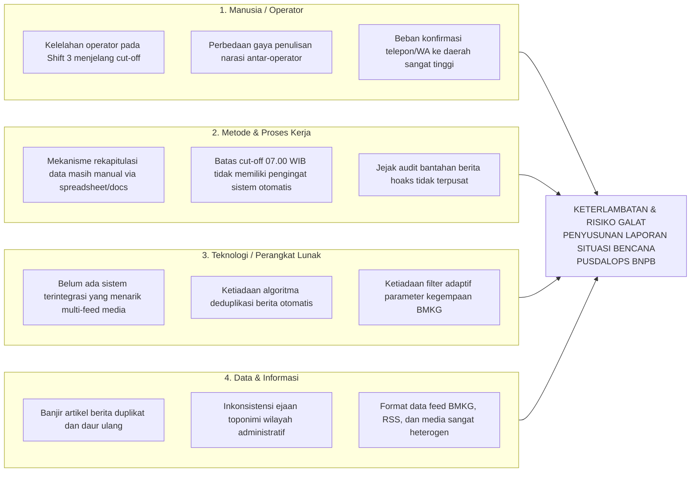

# BAB I: PENDAHULUAN

## 1.1 Latar Belakang

Pusat Pengendalian Operasi Penanggulangan Bencana (Pusdalops-PB) Badan Nasional Penanggulangan Bencana (BNPB) Republik Indonesia mengemban mandat vital berdasarkan Undang-Undang Nomor 24 Tahun 2007 tentang Penanggulangan Bencana untuk memantau situasi kebencanaan di seluruh pelosok Indonesia secara kontinu selama 24 jam non-stop (tiga giliran kerja / *shift* per hari). Salah satu produk luaran (*output*) wajib harian yang paling strategis adalah **Laporan Harian Situasi Bencana (Lapsit / Situation Report Bagian A)**. Laporan ini disampaikan langsung setiap pagi kepada Kepala BNPB, pejabat eselon satu kementerian/lembaga terkait, hingga ke Sekretariat Presiden Republik Indonesia sebagai dasar penetapan status tanggap darurat dan pengerahan logistik bantuan nasional.

Dalam tatanan operasional Pusdalops BNPB, satu siklus pemantauan harian resmi tidak menggunakan batas tanggal kalender biasa (00.00 – 23.59 WIB), melainkan terikat pada aturan **Siklus Operasional 24 Jam (*Windowing*)**, yang dimulai tepat pukul **07.00 WIB pada hari H hingga pukul 07.00 WIB pada hari H+1**. Rentang waktu ini terbagi ke dalam tiga shift dinas:
1. *Shift 1 (Pagi)*: 07.00 – 15.00 WIB
2. *Shift 2 (Sore)*: 15.00 – 23.00 WIB
3. *Shift 3 (Malam/Subuh)*: 23.00 – 07.00 WIB

Tantangan utama yang dihadapi oleh tim piket Pusdalops BNPB saat ini berakar dari proses agregasi dan rekapitulasi data yang masih bersifat manual dan tersebar secara parsial (*fragmented*). Pada setiap shift kerja, operator piket harus membuka puluhan portal berita daring (*Detikcom, Kompas, Antara News, dsb.*), kanal media sosial, kanal pesan instan WhatsApp dari grup relawan/satgas, serta portal peringatan dini kegempaan BMKG secara mandiri. Berdasarkan observasi dan kajian langsung selama pelaksanaan Kerja Praktek, ditemukan kesenjangan (*gap*) signifikan antara kondisi ideal operasional yang dituntut oleh instansi dengan kondisi riil di lapangan.

### 1.1.1 Analisis Kesenjangan Kinerja Operasional (*Performance Gap*)

Tabel 1.1 menyajikan perbandingan antara kondisi ideal standar operasional prosedur (SOP) dengan kondisi aktual di meja piket Pusdalops BNPB.

**Tabel 1.1 Matriks Kesenjangan (*Gap*) Kondisi Operasional Pusdalops BNPB**
| No. | Aspek Operasional | Kondisi Ideal (Target SOP) | Kondisi Aktual di Lapangan | Kesenjangan (*Gap*) |
| :--- | :--- | :--- | :--- | :--- |
| 1 | Waktu Penyusunan & Kompilasi Lapsit Bagian A | Laporan selesai diverifikasi dan diekspor $\le 15$ menit sebelum *cut-off* pukul 07.00 WIB. | Operator membutuhkan waktu 60 – 90 menit untuk rekap manual lintas shift dan pengetikan ulang dokumen Word. | Terjadi keterlambatan 45 – 75 menit yang memicu risiko keterlambatan pengiriman Lapsit ke pimpinan. |
| 2 | Penanganan Duplikasi Berita (*Deduplication*) | Kejadian bencana yang sama dari berbagai media langsung teragregasi menjadi 1 entri kejadian induk dengan multi-referensi. | Berita bencana yang sama disalin berulang kali atau menumpuk di draf laporan, menghabiskan waktu operator untuk memilah secara visual. | 30% – 40% artikel yang diproses merupakan redundansi/daur ulang informasi dari kejadian yang sama. |
| 3 | Penyaringan Anomali Gempa Bumi (*Earthquake Filtering*) | Sistem menyaring gempa secara otomatis hanya pada parameter yang relevan (misal: Gempa $M \ge 5.0$ kedalaman $\le 20$ km atau gempa dangkal berpotensi merusak). | Setiap gempa bermagnitudo kecil di palung laut dalam tetap muncul tanpa klasifikasi urgensi dampak fisik. | Distraksi konsentrasi operator piket terhadap informasi non-urgensi. |
| 4 | Validasi Berita Hoaks & Isu Bantuan Lapangan | Berita hoaks terdata dengan alasan bantahan resmi, dan keluhan logistik warga segera ditandai (*alerting*). | Penolakan berita hoaks tidak memiliki jejak audit resmi yang terstruktur, dan keluhan logistik warga sering terlewat dalam tumpukan narasi panjang. | Hilangnya jejak forensik verifikasi dan risiko keterlambatan respon bantuan darurat. |
| 5 | Format Keluaran Dokumen (*Export SLA*) | Ekspor satu-klik instan ke format naskah dinas Word (`.docx`) dan format klaster WhatsApp pimpinan. | Proses *copy-paste* berulang dari catatan teks ke Microsoft Word, rawan kesalahan tata naskah dan format indentasi. | Pemborosan *man-hour* dan potensi galat ketik (*human error*). |

Berdasarkan data observasi selama 30 hari pemantauan, rata-rata volume artikel bencana yang beredar di media nasional mencapai 180 – 250 artikel per hari. Dari jumlah tersebut, sekitar 70 – 100 artikel sebenarnya merujuk pada peristiwa bencana yang sama namun dilaporkan dengan judul berbeda oleh berbagai media. Tanpa otomasi deduplikasi teks, beban kognitif operator piket meningkat drastis terutama pada Shift 3 (Malam/Subuh menjelang *cut-off* 07.00 WIB), yang seringkali mengakibatkan ketidakakuratan data dampak korban dan sarana prasarana.

### 1.1.2 Relevansi dengan *Complex Computing Problem* (Seoul Accord)

Permasalahan yang diangkat ini memenuhi seluruh kriteria **Complex Computing Problem** sebagaimana ditetapkan oleh Fakultas Rekayasa Industri Telkom University dan Seoul Accord:
1. **Permasalahan Teknis Beragam & Saling Bertentangan (*Conflicting Requirements*)**: Sistem harus menyediakan data secara *real-time* dan cepat, namun di sisi lain harus menjamin keakuratan faktual (*zero-tolerance for misinformation*) serta kepatuhan ketat terhadap format Tata Naskah Dinas BNPB.
2. **Tidak Memiliki Solusi Tunggal/Pasti (*Open-Ended Solutions*)**: Penentuan apakah dua berita berbeda melaporkan bencana yang sama tidak bisa diselesaikan dengan pencarian kata kunci sederhana (*string match*), melainkan membutuhkan pendekatan komputasi linguistik/NLP (*Cosine Similarity*, pembersihan stopword, ekstraksi toponimi wilayah Kemendagri, serta ambang batas kemiripan bertingkat).
3. **Domain Keilmuan yang Mendalam (*Depth of Knowledge Required*)**: Memerlukan penerapan keilmuan sistem informasi komprehensif, mencakup *Data/Information Management* (pipeline ingestion dan normalisasi data heterogen), *Software Engineering/Development* (Django Web Architecture, arsitektur *event-driven* asinkron Celery, dan generator dokumen Office Open XML via *python-docx*), serta *IS Project Management*.
4. **Keterlibatan Multi-Pemangku Kepentingan (*Stakeholders*)**: Melibatkan operator meja piket Pusdalops, pejabat struktural BNPB, tim satgas BPBD provinsi/kabupaten/kota di seluruh Indonesia, serta rujukan media massa daring.

---

## 1.2 Alternatif Solusi

Untuk memecahkan permasalahan di meja piket Pusdalops BNPB, dilakukan analisis akar penyebab masalah (*root cause analysis*) menggunakan **Diagram Tulang Ikan (*Fishbone Diagram*)** sebagaimana disajikan pada Gambar 1.1.

### 1.2.1 Analisis Akar Masalah (*Fishbone Diagram*)

Dari hasil pemetaan diagram di atas, disusun tabel identifikasi potensi alternatif solusi berdasarkan akar masalah utama:

**Tabel 1.2 Identifikasi Alternatif Solusi Permasalahan**
| No. | Akar Masalah | Alternatif Solusi 1 (Konvensional) | Alternatif Solusi 2 (Semi-Otomatis / Bot Pesan) | Alternatif Solusi 3 (Sistem Otomasi Terintegrasi Berbasis Web & NLP) |
| :--- | :--- | :--- | :--- | :--- |
| 1 | Beban kompilasi data manual lintas shift | Menambah jumlah personil operator piket per shift. | Menggunakan bot Telegram/WhatsApp pengumpul tautan berita ke grup dinas. | Membangun platform web pemantauan terpusat dengan *Windowing Engine* 24 jam (07.00–07.00 WIB) otomatis. |
| 2 | Redundansi artikel berita kejadian yang sama | Operator memilah satu per satu secara manual. | Mengelompokkan berdasarkan tanggal tayang artikel saja. | Menerapkan algoritma **Deduplikasi 2 Lapis (NLP Cosine Similarity + Pencocokan Wilayah Kemendagri & Waktu < 24 Jam)**. |
| 3 | Distraksi parameter gempa kecil non-destruktif | Operator membaca semua rilis BMKG secara manual. | Menetapkan batas magnitudo statis tunggal ($M \ge 5.0$). | Menerapkan **Penyaring Gempa Adaptif** ($M \ge 5.0$ & Kedalaman $\le 20$ km, serta gempa darat dangkal $M \ge 4.5$ dengan guncangan $\ge \text{III MMI}$). |
| 4 | Penandaan keluhan logistik warga di lapangan | Operator membaca teks utuh secara manual. | Tidak ada penandaan khusus. | Fitur deteksi otomatis kata kunci bantuan yang memicu badge visual alarm **`[🚨 ISU BANTUAN]`**. |
| 5 | Pemborosan waktu pembuatan dokumen Lapsit | Pengetikan ulang secara manual ke Microsoft Word dan WhatsApp. | Ekspor teks polos (*plain text*) tanpa format dinas resmi. | **Dual Output Generator Satu-Klik**: Generator Word `.docx` berstandar resmi Tata Naskah Dinas BNPB ($\le 5$ detik) dan format ringkasan WhatsApp pimpinan. |

### 1.2.2 Pemilihan dan Justifikasi Solusi Terbaik

Berdasarkan analisis perbandingan di atas, **Alternatif Solusi 3 (Sistem Otomasi Pemantauan Kebencanaan Pusdalops BNPB Berbasis Web, NLP, dan Dual-Output Generator)** dipilih sebagai solusi yang dirancang dalam proyek Capstone Design ini. 

**Justifikasi Pemilihan:**
1. **Peningkatan Efisiensi Waktu Signifikan**: Mengeliminasi waktu rekapitulasi manual dari 60–90 menit menjadi kurang dari 10 menit (penghematan waktu kerja $> 80\%$).
2. **Kualitas dan Integritas Data Tinggi**: Mengurangi redundansi berita hingga $\ge 85\%$ melalui deduplikasi cerdas, serta menyediakan jejak audit lengkap (*audit trail*) untuk setiap perubahan status data dan bantahan berita hoaks.
3. **Kepatuhan Regulasi Tata Naskah Dinas**: Dokumen yang dihasilkan langsung berformat resmi `.docx` Bagian A dan naskah WhatsApp pimpinan yang siap didistribusikan tanpa memerlukan penataan ulang tata letak (*layouting*) manual.

---

## 1.3 Perumusan Masalah

Berdasarkan latar belakang dan analisis permasalahan yang telah diuraikan, rumusan masalah dalam perancangan Capstone Design ini adalah:

> **"Bagaimana merancang dan membangun sistem informasi pemantauan kebencanaan terintegrasi berbasis web dan pemrosesan teks intelijen yang mampu mengotomasi agregasi data multi-sumber, menyaring anomali dan duplikasi berita bencana, serta menghasilkan laporan situasi resmi berstandar Pusdalops BNPB dalam siklus operasional 24 jam secara cepat, akurat, dan terverifikasi?"**

Rumusan masalah utama tersebut diturunkan ke dalam beberapa sub-pertanyaan penelitian:
1. Bagaimana merancang mekanisme *Windowing Engine* yang memetakan data secara presisi ke dalam siklus operasional 24 jam (07.00 – 07.00 WIB) sesuai shift dinas Pusdalops BNPB?
2. Bagaimana mengimplementasikan algoritma penyaringan gempa bumi adaptif dan deduplikasi teks 2 lapis (*Cosine Similarity*) untuk mereduksi redundansi artikel berita bencana?
3. Bagaimana merancang antarmuka antrean meja piket dan modal verifikasi yang memfasilitasi pencatatan data faktual lapangan, pelacakan isu bantuan logistik, dan pengelolaan berita hoaks?
4. Bagaimana merancang modul *Dual Output Generator* yang mampu mengekspor data terverifikasi ke dalam berkas Microsoft Word (`.docx`) berstandar Tata Naskah Dinas Pusdalops BNPB dengan waktu komputasi $\le 5$ detik serta ringkasan pesan WhatsApp pimpinan?

---

## 1.4 Tujuan Perancangan

Tujuan utama dari proyek Capstone Design ini adalah:
1. Merancang dan membangun arsitektur sistem informasi pemantauan kebencanaan terpadu berbasis framework Django dengan dukungan basis data relasional dan arsitektur *event-driven*.
2. Mengembangkan algoritma *Windowing 24 Jam* (07.00–07.00 WIB) yang dilengkapi fleksibilitas pemindahan siklus kejadian batas waktu dan indikator hitung mundur (*countdown timer*) *cut-off*.
3. Mengembangkan modul intelejen data yang mengintegrasikan penyaring gempa adaptif, penanda alarm isu bantuan logistik, serta algoritma deduplikasi 2 lapis (*similarity score* $\ge 0.80$ teks utuh dan $\ge 0.60$ kesamaan wilayah & waktu).
4. Merancang antarmuka dasbor meja piket 4 tab status (`Pending`, `Terverifikasi`, `Hoaks`, `Semua Data`), modal formulir koreksi metadata 5 blok, formulir tambah kejadian ad-hoc, dan fitur penggabungan berita susulan (*merge*).
5. Mengimplementasikan generator dokumen otomatis yang menghasilkan laporan resmi Microsoft Word (`.docx`) berstandar Bagian A BNPB dengan durasi komputasi $\le 5$ detik serta generator ringkasan teks WhatsApp pimpinan.

---

## 1.5 Manfaat Perancangan

Hasil perancangan sistem ini diharapkan memberikan manfaat nyata bagi berbagai pihak:

### 1. Bagi Pusdalops-PB BNPB
* Meningkatkan produktivitas dan efisiensi kerja tim piket di tiga shift operasional secara drastis melalui pengurangan beban rekap manual.
* Memastikan laporan situasi bencana harian (Lapsit) terbit tepat waktu sebelum batas *cut-off* pukul 07.00 WIB dengan data yang tervalidasi dan konsisten.
* Memberikan kepastian jejak audit digital (*audit log*) atas status verifikasi kejadian, termasuk klarifikasi resmi terhadap peredaran berita hoaks di masyarakat.

### 2. Bagi Pimpinan BNPB dan Pemangku Kebijakan Nasional
* Mempercepat penerimaan ringkasan situasi bencana terkini melalui format pesan instan WhatsApp yang terstruktur per klaster bencana.
* Menyediakan dasar pengambilan keputusan yang valid, cepat, dan terpercaya terkait penetapan status darurat, aktivasi pos komando, dan penyaluran logistik bantuan tanggap darurat.

### 3. Bagi BPBD Provinsi/Kabupaten/Kota dan Masyarakat
* Mempercepat proses konfirmasi lapangan antara satgas pusat dan daerah melalui format data wilayah yang terstandardisasi Kepmendagri.
* Memastikan keluhan warga terkait keterlambatan bantuan logistik di lokasi bencana segera teridentifikasi oleh satgas penanggulangan bencana.

### 4. Bagi Pengembangan Keilmuan Sistem Informasi
* Menjadi studi kasus empiris mengenai penerapan *IS2020 Competency Model* dalam domain manajemen krisis kebencanaan, khususnya integrasi teknologi NLP, arsitektur *data pipeline*, serta otomatisasi dokumen dinas berskala nasional.

---

## 1.6 Pemetaan Komponen Sistem Terintegrasi (5M)

Sesuai ketentuan Pedoman Capstone Design Fakultas Rekayasa Industri, sistem yang dirancang dipetakan ke dalam 5 elemen sistem terintegrasi:

**Tabel 1.3 Pemetaan Objek dan Solusi ke dalam Komponen Sistem Terintegrasi**
| Komponen | Objek Riil Eksisting (Sistem Manual) | Solusi Rancangan Capstone (*Pusdalops Automation System*) |
| :--- | :--- | :--- |
| **Manusia (*People*)** | Operator piket Shift 1, 2, 3 yang menyalin berita secara manual; Personil BPBD yang dihubungi via telepon konvensional. | Pengguna sistem terbagi berdasarkan peran (*Role-Based Access Control* / RBAC): Operator Piket dan Supervisor yang dilengkapi jejak audit otomatis. |
| **Material / Data (*Materials*)** | Artikel berita daring acak, pesan WhatsApp informal, dan rilis teks gempa mentah yang belum terstruktur. | Entri kejadian bencana terstruktur (`kejadian_bencana`), entri rujukan media (`berita_bencana`), dan master wilayah resmi Kepmendagri. |
| **Mesin / Perangkat (*Machines / Tools*)** | Peramban web biasa (*browser tabs* yang terbuka puluhan), aplikasi pengolah kata Microsoft Word terpisah, dan spreadsheet lokal. | Server aplikasi web berbasis Django 5, *Task Queue/Scheduler* Celery Beat, basis data PostgreSQL/SQLite, pustaka `scikit-learn` & `python-docx`. |
| **Informasi (*Information*)** | Tumpukan teks berita tanpa filter redundansi, informasi hoaks yang tercampur, dan naskah laporan yang diketik manual. | Dasbor antrean piket 4 tab status, badge alarm `[🚨 ISU BANTUAN]`, rekomendasi penggabungan berita (*merge*), serta Lapsit Bagian A Word & WhatsApp. |
| **Energi / Sumber Daya (*Energy*)** | Energi *man-hour* dan konsentrasi kognitif operator yang terkuras untuk aktivitas klerikal *copy-paste* berulang. | Efisiensi energi kognitif manusia dialihkan ke tugas strategis (verifikasi lapangan ke daerah), sementara komputasi agregasi ditangani server. |
