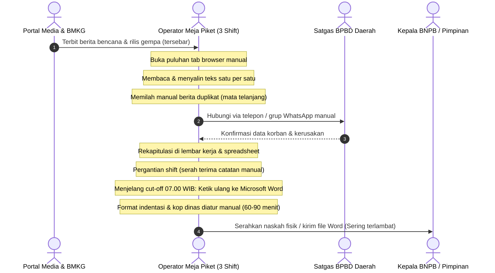
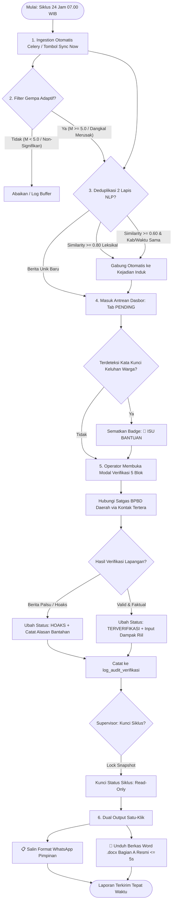
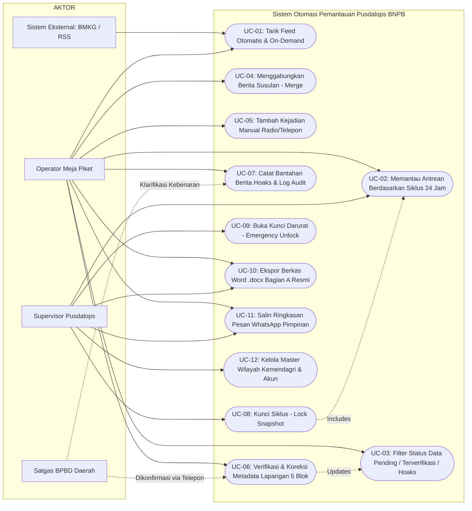
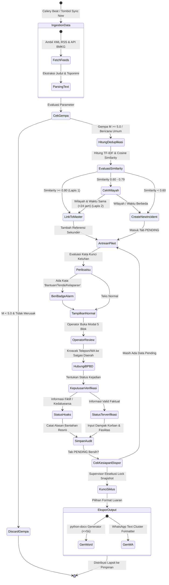
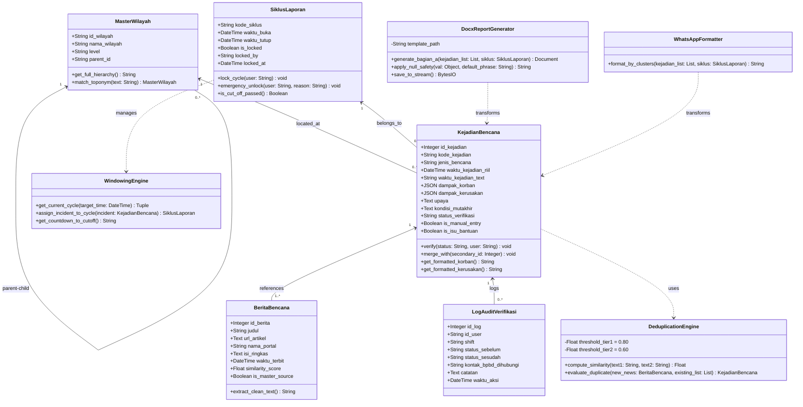
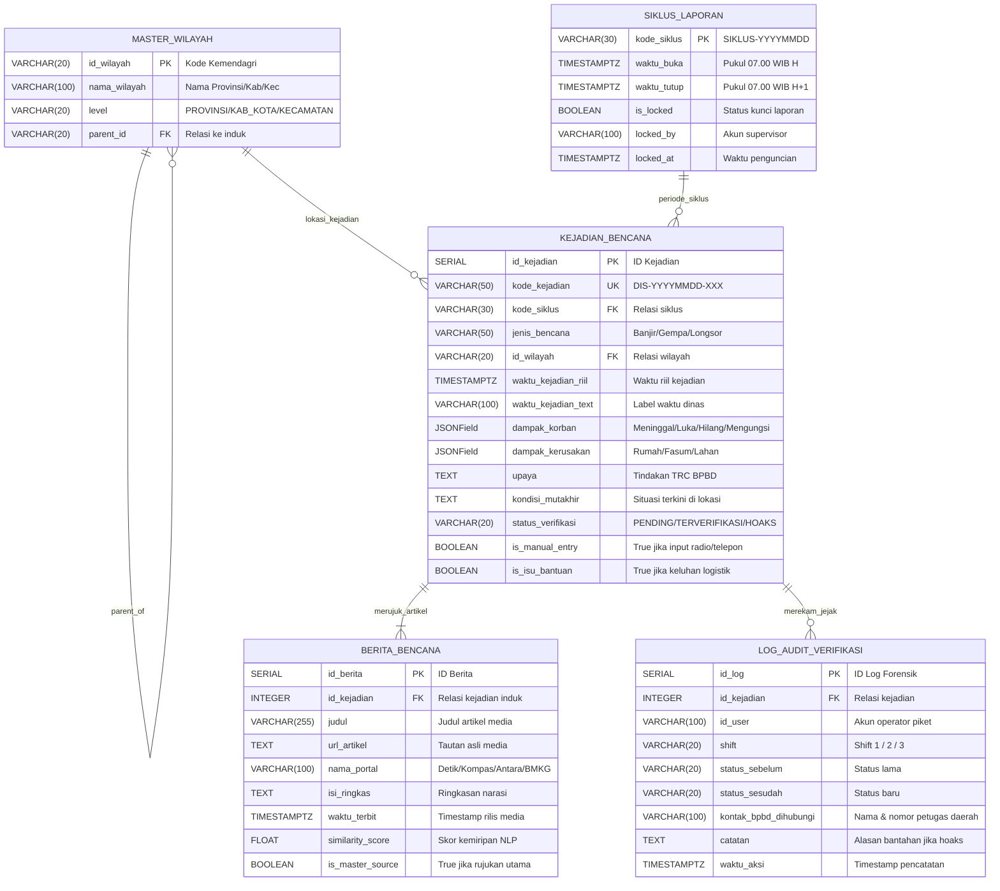
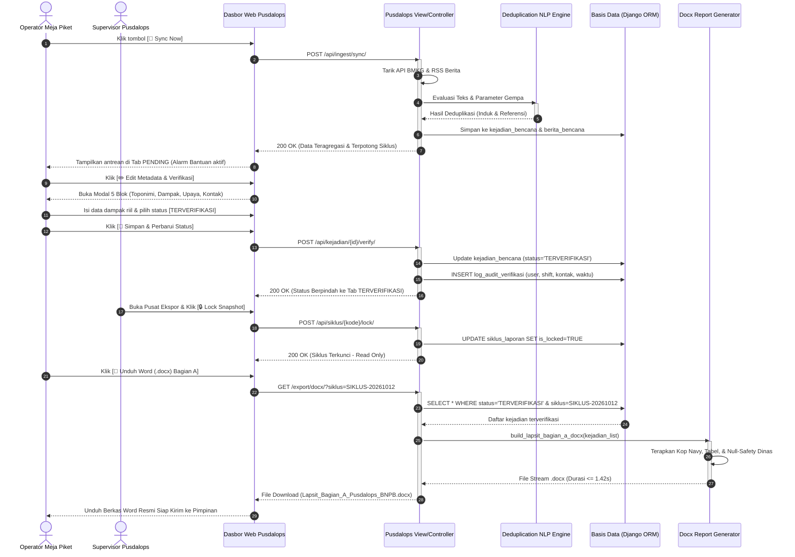

# DOKUMENTASI LENGKAP 7 DIAGRAM PERANCANGAN SISTEM
## Sistem Otomasi Pemantauan Kebencanaan Pusdalops BNPB
**Pembagian Tugas Tim Capstone:**
1. **BPMN AS-IS & TO-BE** — *Abid*
2. **User Interface (UI / Mockup)** — *Seto & Pandhu*
3. **Use Case Diagram & Spesifikasi** — *Adel*
4. **Activity Diagram** — *Abid*
5. **Class Diagram** — *Adel*
6. **Entity Relationship Diagram (ERD)** — *Seto*
7. **Sequence Diagram** — *Pandhu*

---

## 1. BPMN (BUSINESS PROCESS MODEL AND NOTATION) — Penanggung Jawab: Abid

### 1.1 BPMN AS-IS (Proses Bisnis Eksisting / Konvensional)
Proses bisnis yang saat ini berjalan secara manual di meja piket Pusdalops BNPB:

**Karakteristik & Kelemahan Proses AS-IS:**
* **Beban Kognitif Tinggi**: Operator harus memantau banyak portal secara manual 24 jam.
* **Redundansi Berulang**: 30%–40% artikel yang disalin merupakan pengulangan dari kejadian yang sama.
* **Risiko *Human Error***: Pengetikan ulang rentan salah toponimi wilayah dan salah hitung korban.
* **Keterlambatan Ekspor**: Penyusunan laporan Lapsit memakan waktu 60–90 menit menjelang pukul 07.00 WIB.

---

### 1.2 BPMN TO-BE (Proses Bisnis Usulan dengan Sistem Otomasi)
Proses bisnis baru setelah sistem otomasi diterapkan di Pusdalops BNPB:

---

## 2. USER INTERFACE (UI / WIREFRAME & MOCKUP) — Penanggung Jawab: Seto & Pandhu

Sistem antarmuka dirancang dengan empat halaman/modal utama:

### 2.1 UI 1: Dasbor Pemantauan Meja Piket (Halaman Utama)
* **Header Bar**:
  * Logo Pusdalops BNPB + Teks *"Sistem Otomasi Pemantauan Kebencanaan Pusdalops-PB"*.
  * Tombol Quick Trigger: `[🔄 Tarik Data Sekarang / Sync Now]`.
  * Status Operator: *"Petugas: [Nama Operator] | Shift 3 (Malam) | Siklus: SIKLUS-20261012"*.
  * Widget *Countdown Timer Cut-Off*: *"⏳ 06j 14m 20s menuju Cut-Off 07.00 WIB"*.
* **Selector Siklus**:
  * Tombol navigasi: `[◀ Siklus Kemarin]` | `[Pilih Tanggal: YYYY-MM-DD]` | `[Siklus Besok ▶]`.
* **Tab Navigasi Status (4 Tab Dinamis)**:
  1. `🔴 Belum Terverifikasi (Pending)` *(dengan badge jumlah artikel antrean aktif)*.
  2. `🟢 Terverifikasi` *(daftar kejadian valid siap ekspor)*.
  3. `⚫ Hoaks` *(daftar berita ditolak beserta alasan bantahan)*.
  4. `⚪ Semua Data` *(seluruh data siklus)*.
* **Tabel Antrean Data Grid**:
  * Kolom: Waktu Tayang | Jenis Bencana | Wilayah (Provinsi/Kabupaten Kemendagri) | Judul Berita & Ringkasan | Rujukan Media (*Lead + N Sumber*) | Status Badge (`[🚨 ISU BANTUAN]`) | Tombol Aksi: `[🔗 Gabung / Merge]` & `[✏️ Edit Metadata & Verifikasi]`.

---

### 2.2 UI 2: Modal Pop-up "Edit Metadata & Verifikasi" (5 Blok Ringkas)
Modal yang muncul ketika tombol `[✏️ Edit Metadata]` ditekan:
* **Blok 1: Wilayah Kemendagri**:
  * Dropdown bertingkat: *Pilih Provinsi* → *Pilih Kabupaten/Kota* → *Pilih Kecamatan*.
* **Blok 2: Waktu Kejadian Faktual Lapangan**:
  * Input *Tanggal Kejadian* (Date Picker) & *Waktu Kejadian* (Time Picker WIB).
  * Dropdown *Pindahkan ke Siklus* (untuk kejadian batas waktu *edge case*).
* **Blok 3: Fakta Dampak Lapangan**:
  * Korban Jiwa: Meninggal, Luka-Luka, Hilang, Mengungsi (Input numerik dengan default 0).
  * Kerusakan Fisik: Rumah Rusak Berat, Sedang, Ringan, Terendam, Sarana Fasum.
* **Blok 4: Upaya TRC & Situasi Mutakhir**:
  * Textarea: *Upaya Penanganan BPBD di Lokasi*.
  * Textarea: *Kondisi Mutakhir Lapangan (Tinggi Genangan, Cuaca, Situasi)*.
* **Blok 5: Keputusan Status & Jejak Audit**:
  * Radio Button: `( ) PENDING` | `(*) TERVERIFIKASI` | `( ) HOAKS`.
  * Input: *Nama Personil BPBD yang Dikonfirmasi* & *No. Kontak*.
  * Textarea: *Catatan Forensik / Alasan Bantahan (Wajib jika status HOAKS)*.
  * Tombol: `[Batal]` | `[💾 Simpan & Perbarui Status]`.

---

### 2.3 UI 3: Modal "Gabung Berita Susulan (Merge)" & "Tambah Manual"
* **Modal Gabung Berita (`[🔗 Merge]`)**:
  * Menampilkan informasi Berita B yang akan digabung.
  * Dropdown: *Pilih Kejadian Induk A dalam Siklus Berjalan*.
  * Tombol `[Konfirmasi Gabung Berita]` → Memindahkan seluruh rujukan artikel Berita B ke Kejadian Induk A.
* **Modal Tambah Manual (`[+ Tambah Kejadian Manual]`)**:
  * Formulir ad-hoc untuk input bencana dari sambungan telepon darurat / radio HF Pusdalops.

---

### 2.4 UI 4: Pusat Ekspor Laporan (*Export Center & Lock Snapshot*)
* **Pratinjau Format Dokumen Resmi**: Menampilkan preview layout naskah Lapsit Bagian A.
* **Tombol Penguncian (*Lock Snapshot*)**:
  * Tombol `[🔒 Kunci Siklus Laporan]` *(khusus akun Supervisor)* → Mengubah antrean menjadi *read-only*.
  * Tombol `[🔓 Buka Kunci Darurat / Emergency Unlock]` dengan modal alasan pembukaan.
* **Tombol Aksi Ekspor**:
  * `[📄 Unduh Berkas Word (.docx) Bagian A Resmi]` (komputasi $\le 5$ detik).
  * `[📋 Salin Format Ringkasan WhatsApp]` (format klaster dinas).

---

## 3. USE CASE DIAGRAM & SPESIFIKASI — Penanggung Jawab: Adel

### 3.1 Use Case Diagram (UML)

---

## 4. ACTIVITY DIAGRAM — Penanggung Jawab: Abid

### 4.1 Activity Diagram: Verifikasi, Deduplikasi & Ekspor Laporan
Menjelaskan aliran kontrol operasional sistem dari data mentah masuk hingga terbitnya laporan dinas:

---

## 5. CLASS DIAGRAM — Penanggung Jawab: Adel

### 5.1 Class Diagram (Struktur Kelas & Service Architecture)

---

## 6. ENTITY RELATIONSHIP DIAGRAM (ERD) — Penanggung Jawab: Seto

### 6.1 ERD Relasional Basis Data (Crow's Foot Notation)

---

## 7. SEQUENCE DIAGRAM — Penanggung Jawab: Pandhu

### 7.1 Sequence Diagram: Skenario Ingestion, Verifikasi Lapangan, dan Ekspor Laporan Resmi

