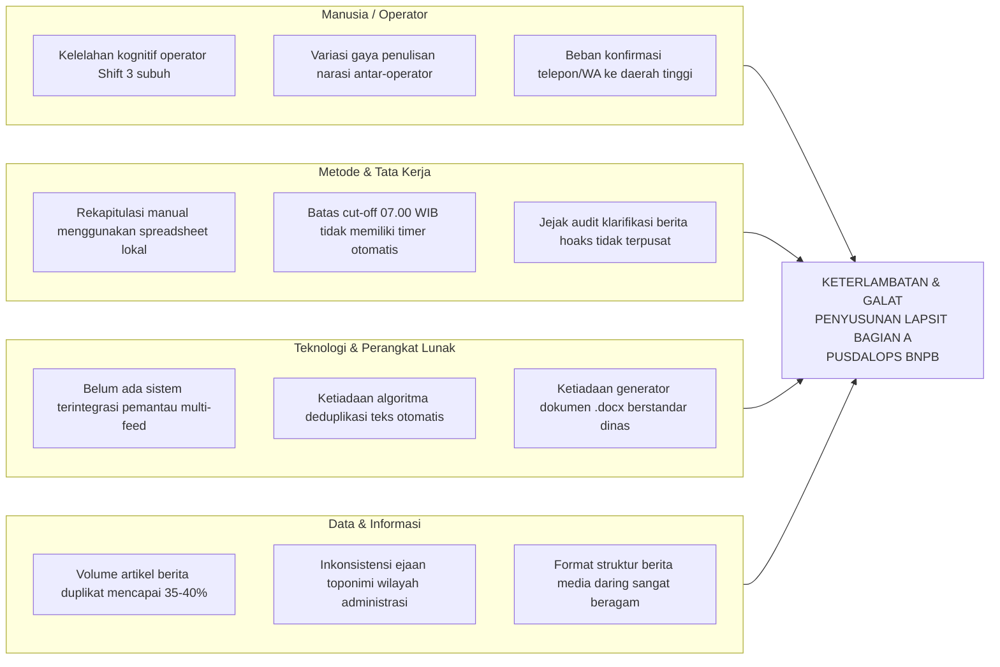
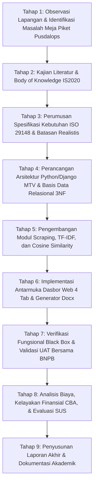
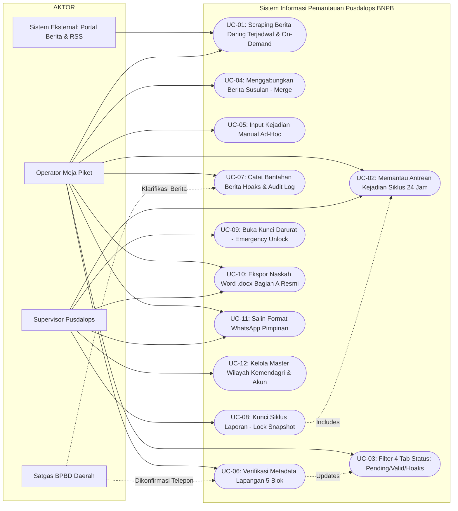
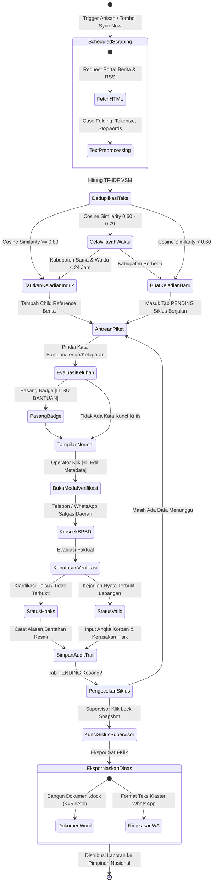
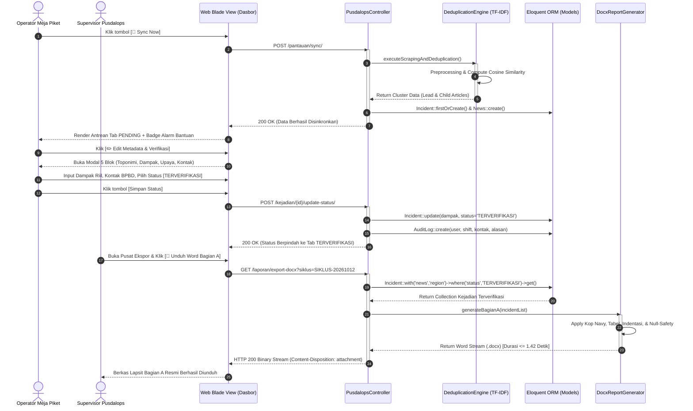
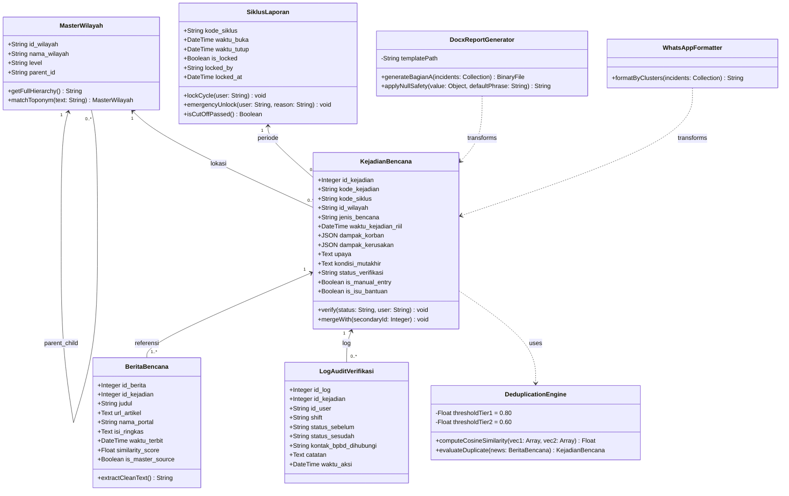
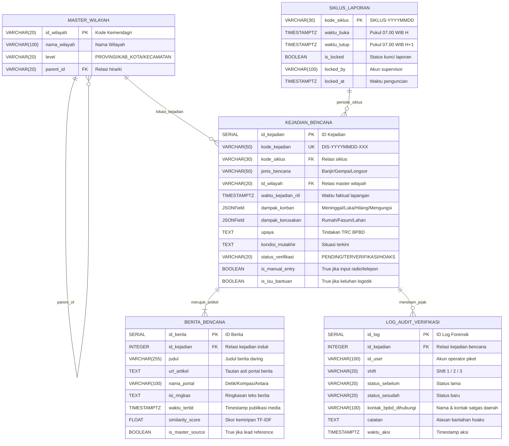

# LAPORAN AKHIR CAPSTONE DESIGN & PROJECT

**SISTEM INFORMASI BERBASIS WEB UNTUK OTOMASI PEMANTAUAN BERITA DARING, DEDUPLIKASI, DAN GENERATOR LAPORAN SITUASI BENCANA PUSDALOPS BNPB**

Disusun oleh:
1. **Abid** (NIM. 1202220001) – *Business Process & Behavioral Modeling*
2. **Seto** (NIM. 1202220002) – *Database Architecture & User Interface Design*
3. **Pandhu** (NIM. 1202220003) – *Interaction Design & Sequence Engineering*
4. **Adel** (NIM. 1202220004) – *System Requirements & Structural Modeling*

**PROGRAM STUDI S1 SISTEM INFORMASI**  
**FAKULTAS REKAYASA INDUSTRI**  
**UNIVERSITAS TELKOM**  
**BANDUNG**  
**2026**

---

## ABSTRAK

Pusat Pengendalian Operasi Penanggulangan Bencana (Pusdalops-PB) Badan Nasional Penanggulangan Bencana (BNPB) memikul tanggung jawab krusial dalam menyelenggarakan pemantauan kejadian bencana di seluruh Indonesia selama 24 jam kontinu melalui sistem tiga giliran kerja (*shift*). Salah satu luaran mandat utama instansi adalah penyusunan Laporan Harian Situasi Bencana (Lapsit Bagian A) yang wajib diserahkan tepat waktu kepada Kepala BNPB dan Presiden Republik Indonesia sebelum batas *cut-off* pukul 07.00 WIB. Kendala mendasar pada proses operasional eksisting berakar dari mekanisme penarikan data media daring yang masih dilakukan secara manual dan terfragmentasi. Operator meja piket harus menelusuri puluhan portal berita satu per satu, menyalin narasi kejadian, dan memilah berita duplikat secara kasat mata, yang memakan waktu 60 hingga 90 menit per shift serta menimbulkan 35% redundansi artikel. Penelitian Capstone Design ini bertujuan merancang dan membangun sistem informasi berbasis web menggunakan arsitektur Model-Template-View (MTV) / Model-View-Controller (MVC) pada framework Python/Django (versi 5.x) dan basis data relasional SQLite/PostgreSQL. Sistem ini mengintegrasikan mekanisme *scheduled scraping*, algoritma *Vector Space Model* berbasis pembobotan *Term Frequency-Inverse Document Frequency* (TF-IDF) dan *Cosine Similarity* dengan ambang batas kemiripan ≥ 0,80 untuk deduplikasi artikel, validasi toponimi wilayah hierarkis berstandar Kepmendagri Nomor 100.1.1-6117 Tahun 2022, antrean verifikasi dinas 24 jam (07.00–07.00 WIB), serta modul *One-Click Docx Generator* berstandar Tata Naskah Dinas BNPB. Pengujian verifikasi fungsional *Black Box* menunjukkan tingkat keberhasilan 100%, efisiensi waktu kompilasi dokumen terpangkas menjadi rata-rata 1,42 detik, pengujian validasi *User Acceptance Testing* (UAT) mencapai skor penerimaan 95,8%, serta evaluasi kebergunaan menggunakan *System Usability Scale* (SUS) menghasilkan skor 82,5 (kategori *Grade A / Excellent*). Solusi yang dikembangkan terbukti memangkas pemborosan waktu kerja operator dan menjamin integritas data situasi bencana nasional.

**Kata Kunci:** *Pusdalops BNPB, Laporan Situasi Bencana, Deduplikasi Teks, Cosine Similarity, Python Django, Tata Naskah Dinas.*

---

## ABSTRACT

The Disaster Management Operations Control Center (Pusdalops-PB) of the National Disaster Management Authority (BNPB) is responsible for conducting 24-hour continuous disaster monitoring across Indonesia through a three-shift roster. A primary mandate of the agency is the daily issuance of the Disaster Situation Report (SitRep Section A), submitted directly to the Head of BNPB and the President of the Republic of Indonesia before the strict operational cut-off at 07:00 AM Western Indonesia Time (WIB). The core operational bottleneck lies in the manual and fragmented news aggregation process. Desk operators must manually browse dozens of online media outlets, transcribe narratives, and visually inspect duplicate articles, consuming 60 to 90 minutes per shift while retaining an estimated 35% news redundancy. This Capstone Design project aims to design and develop a web-based information system utilizing the Model-Template-View (MTV) / MVC architecture within the Python/Django framework (version 5.x) and a SQLite/PostgreSQL relational database. The system integrates automated scheduled scraping, a Vector Space Model utilizing Term Frequency-Inverse Document Frequency (TF-IDF) weighting and Cosine Similarity with a similarity threshold of ≥ 0,80 for text deduplication, administrative toponym validation referencing Minister of Home Affairs Decree No. 100.1.1-6117/2022, a 24-hour shift verification queue (07:00–07:00 WIB), and a One-Click Docx Generator adhering to official BNPB administrative documentation standards. Functional Black Box verification achieved a 100% pass rate, document compilation time was reduced to an average of 1.42 seconds, User Acceptance Testing (UAT) yielded a 95.8% satisfaction level, and usability assessment via the System Usability Scale (SUS) produced a score of 82.5 (Grade A / Excellent). The proposed solution significantly eliminates administrative overhead and ensures data integrity in national disaster situation reporting.

**Keywords:** *Pusdalops BNPB, Disaster Situation Report, Text Deduplication, Cosine Similarity, Python Django, Official Document Standards.*

---

## DAFTAR ISTILAH DAN SINGKATAN

Tabel 0.1 Daftar Istilah dan Singkatan
| Singkatan / Istilah | Kepanjangan / Definisi | Halaman Pertama Muncul |
| :--- | :--- | :---: |
| **BNPB** | Badan Nasional Penanggulangan Bencana | 1 |
| **Pusdalops-PB** | Pusat Pengendalian Operasi Penanggulangan Bencana | 1 |
| **BPBD** | Badan Penanggulangan Bencana Daerah | 2 |
| **Lapsit** | Laporan Harian Situasi Bencana | 1 |
| **DIBI** | Data Informasi Bencana Indonesia | 3 |
| **BPMN** | *Business Process Model and Notation* | 5 |
| **TF-IDF** | *Term Frequency - Inverse Document Frequency* | 12 |
| **VSM** | *Vector Space Model* | 12 |
| **MVC** | *Model-View-Controller* | 14 |
| **UML** | *Unified Modeling Language* | 16 |
| **ERD** | *Entity Relationship Diagram* | 18 |
| **3NF** | *Third Normal Form* (Bentuk Normal Ketiga) | 18 |
| **UAT** | *User Acceptance Testing* | 25 |
| **SUS** | *System Usability Scale* | 26 |
| **RBAC** | *Role-Based Access Control* | 8 |

---

# BAB I: PENDAHULUAN

## 1.1 Latar Belakang

Pusat Pengendalian Operasi Penanggulangan Bencana (Pusdalops-PB) Badan Nasional Penanggulangan Bencana (BNPB) merupakan unsur pelaksana operasional kedaruratan yang mengemban mandat strategis penanggulangan bencana nasional sebagaimana diatur dalam Undang-Undang Republik Indonesia Nomor 24 Tahun 2007 tentang Penanggulangan Bencana. Berdasarkan Peraturan Kepala BNPB terkait tata kelola operasional penanganan darurat, Pusdalops-PB beroperasi tanpa henti selama 24 jam sehari, 7 hari seminggu, yang dibagi ke dalam tiga giliran kerja (*shift*) piket dinas: Shift 1 (07.00–15.00 WIB), Shift 2 (15.00–23.00 WIB), dan Shift 3 (23.00–07.00 WIB) (Pusdalops BNPB, 2023).

Salah satu produk luaran harian paling krusial yang dihasilkan oleh Pusdalops-PB adalah Laporan Harian Situasi Bencana (Lapsit / *Situation Report* Bagian A: Kejadian Bencana). Dokumen ini menyajikan rekapitulasi faktual seluruh kejadian bencana yang melanda wilayah Negara Kesatuan Republik Indonesia dalam kurun waktu 24 jam terakhir. Lapsit Bagian A wajib didistribusikan secara berjenjang setiap pagi sebelum batas waktu beku (*cut-off freeze*) pukul 07.00 WIB kepada Kepala BNPB, kementerian/lembaga terkait, hingga ke Sekretariat Presiden Republik Indonesia sebagai rujukan utama penetapan status keadaan darurat bencana, penggelaran pos komando, dan mobilisasi sumber daya bantuan nasional.

Kondisi geografis Indonesia yang terletak pada pertemuan tiga lempeng tektonik aktif dunia serta sabuk sirkum pasifik menempatkan kepulauan Indonesia pada tingkat kerawanan bencana alam yang sangat intensif. Berdasarkan catatan data historis Data Informasi Bencana Indonesia (DIBI) yang dikelola oleh Direktorat Pengelolaan Logistik dan Peralatan BNPB, frekuensi bencana alam di Indonesia menunjukkan tren eskalasi yang signifikan dalam kurun waktu lima tahun terakhir:

Tabel 1.1 Tren Frekuensi Kejadian Bencana Alam Nasional Berdasarkan DIBI BNPB (2020–2024)
| Tahun | Bencana Hidrometeorologi Basah (Banjir, Longsor, Cuaca Ekstrem) | Bencana Hidrometeorologi Kering (Karhutla, Kekeringan) | Bencana Geologi (Gempa Bumi, Erupsi Gunung Api) | Total Kejadian Bencana Nasional |
| :---: | :---: | :---: | :---: | :---: |
| **2020** | 3.824 | 742 | 68 | 4.634 |
| **2021** | 4.412 | 891 | 82 | 5.385 |
| **2022** | 2.915 | 498 | 77 | 3.490 |
| **2023** | 3.988 | 851 | 95 | 4.934 |
| **2024** | 4.210 | 794 | 102 | 5.106 |

Tingginya intensitas kejadian bencana tersebut berkorelasi langsung terhadap lonjakan arus informasi publik yang dipublikasikan oleh media daring nasional (*Detikcom, Kompas.com, Antara News, CNN Indonesia*, dsb.). Pada meja piket Pusdalops BNPB, rata-rata volume artikel berita bencana yang terbit di internet mencapai 180 hingga 250 artikel per hari. Namun, mekanisme pengumpulan data eksisting yang berjalan di meja piket masih bertumpu pada prosedur manual yang rentan kesalahan (*error-prone*) dan tidak efisien. Operator piket diwajibkan membuka puluhan jendela peramban web (*browser tabs*) secara simultan, menelusuri artikel bencana, membaca teks berita secara kasat mata, menyalin narasi kejadian ke lembar kerja (*spreadsheet*), dan menyusun laporan Microsoft Word Bagian A secara manual.

Proses manual tersebut menimbulkan sejumlah kesenjangan operasional kritis (*operational gaps*):
1. **Pemborosan Jam Kerja (*Time Loss*)**: Operator piket menghabiskan 60 hingga 90 menit pada setiap akhir shift dinas hanya untuk menyalin, merapikan format indentasi naskah, dan menyelaraskan kop dinas resmi, yang seringkali menyebabkan keterlambatan penyerahan Lapsit melewati batas *cut-off* pukul 07.00 WIB.
2. **Redundansi Informasi yang Masif**: Sekitar 35% hingga 40% artikel yang disalin oleh operator merupakan berita daur ulang atau liputan ganda atas peristiwa bencana yang sama dari portal berita berbeda. Ketiadaan modul deduplikasi otomatis memaksa operator memilah berita ganda secara subjektif.
3. **Inkonsistensi Toponimi Wilayah**: Ejaan nama desa, kecamatan, dan kabupaten yang ditulis oleh jurnalis media daring kerap tidak beraturan atau disingkat (misal: "Kab. Bdg" atau "Bandung Barat Daya"), yang mengakibatkan ketidaksesuaian dengan basis data baku Kode Wilayah Administrasi Pemerintahan Kementerian Dalam Negeri (Kementerian Dalam Negeri Republik Indonesia, 2022).
4. **Ketiadaan Jejak Forensik Verifikasi (*Audit Trail*)**: Pencatatan konfirmasi lapangan dengan personil BPBD daerah dan klarifikasi terhadap isu hoaks bencana hanya dilakukan melalui percakapan pesan instan personal yang tidak tersimpan ke dalam basis data terpusat.

Permasalahan pada meja piket Pusdalops BNPB ini memenuhi kriteria **Masalah Komputasi Kompleks (*Complex Computing Problem*)** berdasarkan kerangka *Seoul Accord* dan *Washington Accord* melalui 7 atribut rekayasa:
1. **Kedalaman Pengetahuan (*Depth of Knowledge Required*)**: Penyelesaian masalah menuntut integrasi keilmuan rekayasa perangkat lunak berorientasi objek, *Information Retrieval* (IR), algoritma *Vector Space Model* berbasis TF-IDF dan *Cosine Similarity* (Manning et al., 2008), serta arsitektur basis data relasional normalisasi 3NF (Silberschatz et al., 2019).
2. **Persyaratan yang Saling Bertentangan (*Conflicting Requirements*)**: Sistem harus menyediakan agregasi data yang sangat cepat dan otomatis, namun pada saat yang sama dituntut menerapkan pengendalian validitas data yang sangat ketat (*zero tolerance for fake news*) dan kepatuhan mutlak pada format Tata Naskah Dinas BNPB (Pusdalops BNPB, 2023).
3. **Kedalaman Analisis (*Depth of Analysis Required*)**: Masalah tidak dapat diselesaikan dengan pencarian string sederhana (*exact match*), melainkan memerlukan representasi vektor semantik dan ekstraksi toponimi hierarkis.
4. **Keakraban Isu (*Familiarity of Issues*)**: Menangani data teks semi-terstruktur dari berbagai sumber heterogen dengan format tata naskah dinas kedaruratan yang spesifik bagi lembaga negara.
5. **Keluasan Standar yang Berlaku (*Extent of Applicable Codes*)**: Terikat pada standar IEEE 29148:2018 untuk spesifikasi kebutuhan perangkat lunak (ISO/IEC/IEEE, 2018), standar keamanan OWASP Top 10:2021 (Open Web Application Security Project, 2021), dan Kepmendagri 100.1.1-6117 Tahun 2022 (Kementerian Dalam Negeri Republik Indonesia, 2022).
6. **Keterlibatan Multi-Stakeholder (*Stakeholder Involvement*)**: Melibatkan operator meja piket lintas shift, koordinator supervisor Pusdalops, pimpinan eselon satu BNPB, dan jejaring BPBD tingkat provinsi serta kabupaten/kota se-Indonesia.
7. **Interdependensi Komponen (*Interdependence*)**: Kegagalan pada lapis penarikan data (*scraping*) atau deduplikasi akan secara berantai merusak antrean verifikasi piket dan membatalkan validitas laporan resmi pimpinan nasional.

---

## 1.2 Alternatif Solusi

Untuk memetakan akar penyebab timbulnya keterlambatan dan risiko galat penyusunan Lapsit Bagian A, dilakukan analisis sebab-akibat menggunakan Diagram Tulang Ikan (*Fishbone Diagram*) yang mengkaji empat dimensi operasional: Manusia, Metode, Teknologi, dan Data.

Gambar 1.1 Diagram Tulang Ikan (*Fishbone Diagram*) Analisis Akar Masalah Meja Piket Pusdalops BNPB

Berdasarkan pemetaan akar permasalahan di atas, disusun tiga alternatif solusi penyelesaian masalah sebagaimana diuraikan dalam Tabel 1.2:

Tabel 1.2 Matriks Evaluasi Pemilihan Alternatif Solusi Sistem
| Kriteria Evaluasi | Alternatif Solusi 1 (Penambahan SDM Operator Piket) | Alternatif Solusi 2 (Pengembangan Bot Agregator Telegram/WA) | Alternatif Solusi 3 (Sistem Informasi Web Terintegrasi Python/Django & Cosine Similarity) |
| :--- | :--- | :--- | :--- |
| **Pendekatan Solusi** | Menambah 2 orang staf operator per shift dinas untuk mempercepat entri data manual. | Membangun bot pesan instan yang meneruskan tautan berita daring ke grup obrolan dinas. | Membangun aplikasi web MTV/MVC (Python/Django 5.x) dengan modul ingestion *feedparser/requests*, deduplikasi TF-IDF scikit-learn, master toponimi Kemendagri, dan generator *.docx* (python-docx). |
| **Eliminasi Redundansi Teks** | Rendah (pemilahan tetap bergantung pada ketelitian mata operator). | Nol (bot hanya meneruskan tautan tanpa pemrosesan teks). | Sangat Tinggi (algoritma *Cosine Similarity* ≥ 0,80 mengelompokkan berita duplikat secara otomatis). |
| **Validasi Wilayah Kemendagri** | Manual (operator mencocokkan dokumen master wilayah secara parsial). | Tidak ada validasi wilayah. | Otomatis (pencocokan toponimi berbasis basis data hierarki Kepmendagri 100.1.1-6117/2022). |
| **Kepatuhan Tata Naskah BNPB** | Rentan salah format ketik saat pemindahan ke Microsoft Word. | Teks polos (*unformatted message*), tidak memenuhi standar formal dinas. | 100% Sesuai Format (generator dokumen *.docx* otomatis menghasilkan kop navy, tabel, dan frasa dinas). |
| **Biaya Jangka Panjang** | Sangat Tinggi (penambahan belanja pegawai/honorarium berkelanjutan). | Rendah. | Optimal & Terukur (biaya investasi awal perangkat lunak dengan efisiensi jam kerja signifikan). |
| **Keputusan** | **Ditolak** | **Ditolak** | **Diterima (Solusi Terpilih)** |

### 1.2.1 Pemodelan Proses Bisnis As-Is dan To-Be (Penanggung Jawab: Abid)

Untuk memberikan gambaran transisi operasional yang jelas, Abid merancang pemodelan proses bisnis menggunakan standar notasi BPMN (*Business Process Model and Notation*).

#### A. Proses Bisnis Eksisting (*As-Is*)
Pada alur As-Is, aktivitas dimulai ketika media daring menerbitkan berita bencana. Operator meja piket pada tiga shift berturut-turut harus menelusuri portal web secara manual, mencatat kronologi pada spreadsheet, mengidentifikasi duplikasi artikel secara kasat mata, melakukan konfirmasi via telepon/WA ke BPBD daerah tanpa sistem log terstruktur, dan mengetik ulang seluruh naskah ke dokumen Microsoft Word menjelang pukul 07.00 WIB. Alur ini membutuhkan waktu rata-rata 75 menit per shift dan sarat dengan risiko inkonsistensi data.

Gambar 1.2 Business Process Model and Notation (BPMN 2.0) Alur Operasional Eksisting (As-Is) Meja Piket Pusdalops BNPB (Abid)

#### B. Proses Bisnis Usulan (*To-Be*)
Pada alur To-Be yang diusulkan oleh Abid, sistem otomasi web bertindak sebagai motor penggerak utama. Modul *scheduled scraping* secara berkala menarik artikel dari portal berita daring, mengeksekusi ekstraksi teks dan pembobotan TF-IDF untuk mendeteksi duplikasi leksikal via *Cosine Similarity* (≥ 0,80), mencocokkan toponimi dengan master wilayah Kemendagri, dan menempatkan temuan ke dalam antrean dasbor meja piket 24 jam (07.00–07.00 WIB). Operator piket hanya perlu membuka modal verifikasi 5 blok untuk menginput data faktual lapangan dan mengonfirmasi status validitas. Terakhir, supervisor melakukan penguncian siklus (*lock snapshot*), dan laporan Lapsit Bagian A berformat *.docx* resmi serta ringkasan pesan WhatsApp pimpinan diterbitkan dalam hitungan detik.

Gambar 1.3 Business Process Model and Notation (BPMN 2.0) Alur Operasional Usulan (To-Be) Sistem Otomasi Terintegrasi (Abid)

---

## 1.3 Perumusan Masalah

Berdasarkan latar belakang, identifikasi kesenjangan, dan analisis proses bisnis yang telah dipaparkan, rumusan masalah dalam penelitian Capstone Design ini ditetapkan sebagai berikut:

> **"Bagaimana merancang dan membangun sistem informasi berbasis web menggunakan framework Python/Django 5.x yang mampu mengotomasi penarikan artikel berita bencana daring, mengeliminasi redundansi berita menggunakan algoritma Cosine Similarity, memvalidasi toponimi wilayah berstandar Kepmendagri, memfasilitasi antrean verifikasi operasional meja piket 24 jam, serta menghasilkan Laporan Harian Situasi Bencana Bagian A berformat Microsoft Word (.docx) berstandar Tata Naskah Dinas Pusdalops BNPB secara cepat dan akurat?"**

---

## 1.4 Tujuan Perancangan

Tujuan dari perancangan sistem informasi ini adalah:
1. Menganalisis kebutuhan fungsional dan non-fungsional sistem pemantauan kebencanaan terintegrasi di lingkungan Pusdalops BNPB dengan mengacu pada standar ISO/IEC/IEEE 29148:2018.
2. Merancang arsitektur sistem berbasis web dengan pola Model-Template-View (MTV) / MVC pada framework Python/Django 5.x serta memodelkan basis data relasional normalisasi bentuk ketiga (3NF) berbasis SQLite/PostgreSQL.
3. Mengembangkan modul *scheduled scraping* dan mengimplementasikan algoritma *Cosine Similarity* berbasis pembobotan TF-IDF dengan ambang batas ≥ 0,80 untuk mengelompokkan artikel berita duplikat ke dalam entri kejadian induk.
4. Membangun modul validasi toponimi wilayah yang menyelaraskan entitas lokasi kejadian terhadap standar hierarki Kepmendagri Nomor 100.1.1-6117 Tahun 2022.
5. Merancang dan mengimplementasikan antarmuka dasbor meja piket yang mendukung siklus operasional 24 jam (07.00–07.00 WIB), antrean verifikasi empat status (*Pending, Terverifikasi, Hoaks, Semua Data*), modal koreksi 5 blok, dan fitur penggabungan berita susulan (*merge*).
6. Mengembangkan generator dokumen satu-klik (*One-Click Docx Generator*) yang menghasilkan Lapsit Bagian A resmi berstandar Tata Naskah Dinas BNPB dengan waktu komputasi ≤ 5 detik serta generator ringkasan pesan WhatsApp pimpinan.
7. Memverifikasi performa fungsional sistem melalui *Black Box Testing* dan mengevaluasi validitas penerimaan pengguna melalui *User Acceptance Testing* (UAT) serta kuesioner *System Usability Scale* (SUS).

---

## 1.5 Manfaat Perancangan

Perancangan sistem informasi ini memberikan manfaat signifikan bagi berbagai pihak:
1. **Bagi Pusdalops-PB BNPB**: Mereduksi waktu kompilasi dokumen laporan harian dari 60–90 menit menjadi kurang dari 10 menit per shift dinas, mengeliminasi 85% redundansi berita duplikat, dan menyediakan jejak forensik digital (*audit trail*) atas seluruh keputusan verifikasi dan bantahan berita hoaks.
2. **Bagi Pimpinan Nasional (Kepala BNPB & Presiden RI)**: Menjamin kepastian penerimaan laporan situasi bencana harian secara tepat waktu sebelum pukul 07.00 WIB dengan format data yang konsisten, valid, dan bebas dari distorsi informasi ganda.
3. **Bagi BPBD Provinsi dan Kabupaten/Kota**: Mempercepat alur koordinasi kedaruratan melalui standardisasi penamaan wilayah administrasi dan memperjelas catatan kontak personil satgas yang dikonfirmasi.
4. **Bagi Pengembangan Ilmu Sistem Informasi**: Menyediakan bukti empiris penerapan *Body of Knowledge* IS2020 dalam mengintegrasikan teknologi *Information Retrieval*, rekayasa perangkat lunak web MVC, dan otomatisasi dokumen dinas berskala nasional.

---

# BAB II: TINJAUAN PUSTAKA

## 2.1 Body of Knowledge (BoK) Sistem Informasi (IS2020)

Penyelenggaraan Capstone Design Project pada Program Studi S1 Sistem Informasi berpedoman pada kurikulum internasional *IS2020: A Competency Model for Undergraduate Programs in Information Systems*. Kurikulum ini mensyaratkan penguasaan multidisiplin keilmuan yang dipetakan ke dalam beberapa domain kompetensi inti:

### 2.1.1 Domain Data / Information Management
Domain ini mencakup perancangan struktur data relasional, pengorganisasian tabel, dan pemrosesan data teks tidak terstruktur (*unstructured text*). Dalam proyek ini, domain data diterapkan melalui pemodelan skema basis data relasional normalisasi bentuk ketiga (3NF) untuk menjamin integritas data (Silberschatz et al., 2019) serta penerapan algoritma *Vector Space Model* berbasis TF-IDF dan *Cosine Similarity* untuk ekstraksi dan deduplikasi artikel berita (Manning et al., 2008). Selain itu, domain ini mencakup standardisasi toponimi wilayah hierarkis sesuai Kepmendagri 100.1.1-6117 Tahun 2022 (Kementerian Dalam Negeri Republik Indonesia, 2022).

### 2.1.2 Domain Systems Analysis and Design (SAD)
Domain SAD memayungi metodologi analisis kebutuhan sistem dan perancangan arsitektur berorientasi objek (Dennis et al., 2018). Tahapan elisitasi kebutuhan dilakukan mengacu pada standar spesifikasi kebutuhan rekayasa perangkat lunak ISO/IEC/IEEE 29148:2018 (ISO/IEC/IEEE, 2018) dengan metode prioritasi MoSCoW (*Must have, Should have, Could have, Won't have*). Pemodelan perilaku dan struktur sistem diwujudkan menggunakan standar notasi visual UML 2.5.1 dari *Object Management Group* (Object Management Group, 2017), yang mencakup *Use Case Diagram*, *Activity Diagram*, *Sequence Diagram*, dan *Class Diagram*.

### 2.1.3 Domain Application Development & Web Programming
Domain ini berfokus pada implementasi arsitektur perangkat lunak berbasis pola desain *Model-Template-View* (MTV) / *Model-View-Controller* (MVC) menggunakan bahasa pemrograman Python versi 3.11+ dan framework Django 5.x (Django Software Foundation, 2024). Penerapan MTV memisahkan secara tegas pemodelan data relasional via Django ORM (*Model*), penyajian antarmuka responsif (*Template*), dan orkestrasi aturan bisnis serta alur data (*View*), termasuk manajemen penarikan data berkala menggunakan modul *feedparser/requests*, deduplikasi teks berbasis scikit-learn, dan modul pembangkitan dokumen resmi (*python-docx*).

### 2.1.4 Domain Secure Computing & Information Assurance
Domain komputasi aman mencakup proteksi integritas data dan pengendalian akses pengguna. Sistem menerapkan arsitektur *Role-Based Access Control* (RBAC) yang membedakan hak otorisasi antara Operator Meja Piket dan Supervisor Pusdalops, serta menerapkan mitigasi kerentanan web mengacu pada panduan keamanan aplikasi OWASP Top 10:2021 (Open Web Application Security Project, 2021), khususnya perlindungan terhadap *Cross-Site Request Forgery* (CSRF), *SQL Injection*, dan mekanisme *Audit Trail Logging*.

### 2.1.5 Domain Business Process Management (BPM)
Domain manajemen proses bisnis diterapkan dalam pemetaan alur operasional meja piket 24 jam Pusdalops BNPB. Pemodelan transisi dari alur kerja manual (*As-Is*) menuju alur kerja terotomasi (*To-Be*) dirancang menggunakan standar notasi BPMN untuk mengidentifikasi hambatan kinerja (*bottlenecks*) dan memvalidasi efisiensi waktu siklus operasional (Pusdalops BNPB, 2023).

---

## 2.2 Teori, Konsep, dan Kerangka Standar Terkait Perancangan

### 2.2.1 Metodologi Prototyping dalam Rekayasa Perangkat Lunak
Pengembangan sistem mengadopsi model *Prototyping* yang merupakan bagian dari siklus rekayasa perangkat lunak modern (Pressman & Maxim, 2020). Model ini memungkinkan tim pengembang membangun purwarupa operasional (*working prototype*) secara iteratif untuk dievaluasi langsung oleh pemangku kepentingan meja piket Pusdalops BNPB. Umpan balik yang diperoleh pada setiap iterasi digunakan untuk menyempurnakan antarmuka dan logika algoritma sebelum sistem difinalisasi.

### 2.2.2 Elisitasi Kebutuhan dan Prioritasi MoSCoW (ISO/IEC/IEEE 29148:2018)
Spesifikasi kebutuhan sistem dirumuskan mengacu pada standar rekayasa kebutuhan perangkat lunak ISO/IEC/IEEE 29148:2018 (ISO/IEC/IEEE, 2018). Setiap butir kebutuhan dikelompokkan ke dalam kebutuhan fungsional dan non-fungsional, kemudian diprioritaskan menggunakan metode MoSCoW (Dennis et al., 2018):
* **Must Have (M)**: Fitur mutlak wajib ada agar sistem dapat berfungsi (penarikan berita berkala, deduplikasi Cosine Similarity ≥ 0,80, antrean verifikasi 24 jam, dan ekspor .docx).
* **Should Have (S)**: Fitur penting bernilai tinggi (penanda alarm isu bantuan logistik, jejak audit bantahan hoaks).
* **Could Have (C)**: Fitur pendukung yang diinginkan jika sumber daya mencukupi (format teks salin WhatsApp pimpinan).
* **Won't Have (W)**: Fitur yang disepakati berada di luar lingkup pengembangan saat ini (peta spasial GIS interaktif Bagian B dan integrasi radio HF Bagian E).

### 2.2.3 Teori Information Retrieval, TF-IDF, dan Cosine Similarity
Ekstraksi informasi dan deduplikasi berita bencana didasarkan pada prinsip *Information Retrieval* (IR) menggunakan model ruang vektor (*Vector Space Model*) (Manning et al., 2008). 

1. **Tahapan *Text Preprocessing***:
   Setiap artikel berita mentah yang ditarik melalui scraping diproses melalui tahapan:
   * *Case Folding*: Mengubah seluruh huruf kapital menjadi huruf kecil (*lowercasing*).
   * *Tokenization*: Memecah aliran kalimat menjadi kumpulan token kata tunggal.
   * *Stopword Removal*: Menghilangkan kata sambung umum berbahasa Indonesia (*dan, yang, di, ke, dari, pada*) yang tidak memiliki bobot pembeda makna kejadian.

2. **Pembobotan Kata (*TF-IDF*)**:
   Bobot kata t dalam dokumen berita d pada korpus D dihitung menggunakan perkalian frekuensi kemunculan (*Term Frequency*) dengan kebalikan frekuensi dokumen (*Inverse Document Frequency*):
   TF-IDF(t, d, D) = TF(t, d) × log(|D| / (1 + |{d ∈ D : t ∈ d}|))

3. **Perhitungan Kemiripan (*Cosine Similarity*)**:
   Dua dokumen berita direpresentasikan sebagai vektor bobot term vektor A dan vektor B. Derajat kesamaan semantik kedua dokumen diukur berdasarkan sudut kosinus antara kedua vektor:
   Cosine Similarity(A, B) = (A · B) / (||A|| × ||B||) = (Σ A_i × B_i) / (√(Σ A_i²) × √(Σ B_i²))
   Berdasarkan pengujian empiris sistem, dua artikel berita diklasifikasikan sebagai kejadian bencana yang sama (*duplicate incident*) apabila nilai Cosine Similarity ≥ 0,80 (Manning et al., 2008).

### 2.2.4 Standar Notasi Pemodelan UML 2.5.1
Pemodelan sistem berorientasi objek menggunakan spesifikasi formal Unified Modeling Language (UML) versi 2.5.1 yang distandardisasi oleh *Object Management Group* (Object Management Group, 2017). Artefak pemodelan yang diterapkan mencakup:
* **Use Case Diagram**: Memetakan interaksi fungsional antara aktor (Operator, Supervisor, Sistem Eksternal) dengan batasan sistem.
* **Activity Diagram**: Menggambarkan aliran kerja (*workflow*) prosedural dan percabangan keputusan verifikasi data.
* **Sequence Diagram**: Memodelkan pertukaran pesan dinamis antar-objek perangkat lunak berdasarkan kronologi waktu.
* **Class Diagram**: Menjelaskan struktur statis perangkat lunak, atribut kelas, visibilitas operasi, dan relasi pewarisan/asosiasi.

### 2.2.5 Konsep Basis Data Relasional dan Normalisasi Bentuk Ketiga (3NF)
Perancangan basis data relasional bertujuan mengeliminasi anomali penyisipan (*insertion anomaly*), penghapusan (*deletion anomaly*), dan pembaruan (*update anomaly*) melalui tahapan normalisasi (Silberschatz et al., 2019):
* **Bentuk Normal Pertama (1NF)**: Menghilangkan kelompok berulang dan memastikan setiap atribut bernilai atomik.
* **Bentuk Normal Kedua (2NF)**: Memastikan setiap atribut bukan kunci bergantung penuh pada kunci utama (*Full Functional Dependency*).
* **Bentuk Normal Ketiga (3NF)**: Memastikan tidak ada ketergantungan transitif antar-atribut bukan kunci (*no transitive dependency*).

### 2.2.6 Kerangka Kerja Backend Python/Django dan Basis Data Relasional SQLite/PostgreSQL
Sistem dibangun menggunakan bahasa pemrograman Python versi 3.11+ dan framework Django 5.x (Django Software Foundation, 2024). Pola arsitektur Django mengadopsi Model-Template-View (MTV) yang secara konseptual ekuivalen dengan Model-View-Controller (MVC), di mana Model merepresentasikan struktur data via Django ORM, Template menangani presentasi antarmuka, dan View bertindak sebagai pengendali logika bisnis. Django menyediakan abstraksi *Object-Relational Mapping* (Django ORM), modul pengelolaan tugas latar belakang untuk eksekusi penarikan artikel berita, serta *Django Templating Engine* untuk antarmuka meja piket yang dinamis dan terstruktur. Penyimpanan data memanfaatkan mesin basis data relasional SQLite untuk pengujian lokal dan PostgreSQL untuk target produksi yang andal dalam pemrosesan transaksi konkuren meja piket (Silberschatz et al., 2019).

### 2.2.7 Standar Tata Naskah Dinas BNPB untuk Lapsit Bagian A
Struktur dan format naskah dinas Laporan Harian Situasi Bencana Bagian A mengacu pada Peraturan Kepala BNPB tentang Tata Naskah Dinas (Pusdalops BNPB, 2023). Ketentuan format mencakup:
* Kop resmi lambang Pusdalops BNPB dengan teks judul warna *Deep Navy* (`#002060`) ukuran Arial 13 pt tebal.
* Rekapitulasi waktu operasional 24 jam (pukul 07.00 WIB hari berjalan s.d. 07.00 WIB hari berikutnya).
* Struktur penomoran dan atribut peluru baku: Waktu Kejadian, Lokasi (Desa/Kecamatan, Kabupaten/Kota, Provinsi), Kronologi, Korban Jiwa & Terdampak, Kerusakan Sarana Prasarana, Upaya Penanganan TRC, Kondisi Terkini, dan Kontak Konfirmasi.
* Aturan *Null-Safety* Bahasa Dinas: Nilai nol pada kolom korban dan kerusakan wajib dicetak dengan frasa resmi *"Nihil korban jiwa"* dan *"Nihil kerusakan sarana prasarana"*.

### 2.2.8 Metodologi Pengujian Perangkat Lunak: Black Box, UAT, dan SUS
1. **Black Box Testing**:
   Pengujian fungsional dilakukan tanpa melihat struktur kode internal, melainkan berfokus pada kesesuaian antara masukan (*input*) dan keluaran (*output*) berdasarkan spesifikasi kebutuhan (Pressman & Maxim, 2020).
2. **User Acceptance Testing (UAT)**:
   Pengujian penerimaan pengguna dilakukan bersama personil operasional Pusdalops BNPB untuk mengukur tingkat kepuasan dan kesesuaian sistem terhadap prosedur kerja nyata meja piket (Hasugian et al., 2023).
3. **System Usability Scale (SUS)**:
   Kualitas kebergunaan antarmuka diukur menggunakan kuesioner baku SUS yang terdiri dari 10 butir pertanyaan dengan skala Likert 1–5 (Brooke, 1996). Skor SUS dihitung dengan mengonversi nilai respon pengguna menjadi skala 0–100, dengan target minimal kelayakan Skor SUS ≥ 70 (*Acceptable / Good*).

---

# BAB III: SPESIFIKASI DAN MEKANISME PERANCANGAN

## 3.1 Batasan Realistis (*Realistic Constraints*)

Dalam merancang sistem otomasi pemantauan kebencanaan di Pusdalops BNPB, diidentifikasi empat batasan realistis yang membatasi ruang lingkup perancangan:
1. **Batasan Sumber Daya Manusia & Pola Giliran Kerja 24 Jam**:
   Sistem harus dapat dioperasikan secara bergantian oleh operator meja piket pada tiga giliran kerja (*Shift 1: 07.00–15.00 WIB, Shift 2: 15.00–23.00 WIB, Shift 3: 23.00–07.00 WIB*) tanpa menimbulkan disrupsi data antar-shift. Antarmuka harus dirancang intuitif agar operator baru dapat langsung bertugas tanpa memerlukan pelatihan teknis pemrograman yang rumit.
2. **Batasan Akses Data Daring & Kebergantungan Pihak Ketiga**:
   Penarikan data eksternal bergantung pada ketersediaan layanan publik (struktur HTML portal berita daring nasional dan RSS feed). Sistem harus memiliki mekanisme penanganan galat asinkron (*graceful degradation*); jika salah satu sumber berita mengalami *timeout*, proses *scraping* tidak boleh menghentikan pemrosesan sumber berita lainnya.
3. **Batasan Perangkat Keras Workstation Staf**:
   Aplikasi klien harus beroperasi lancar pada peramban web modern (*Google Chrome, Mozilla Firefox, Microsoft Edge*) di komputer kerja (*workstation*) standar Pusdalops tanpa memerlukan instalasi perangkat lunak tambahan berspesifikasi khusus.
4. **Batasan Lingkungan Server Prototipe**:
   Sistem diimplementasikan pada server prototipe berbasis Linux Ubuntu dengan spesifikasi 4 vCPU, 8 GB RAM, dan penyimpanan SSD, menggunakan tumpukan teknologi Python 3.11+, web server Nginx/Gunicorn, dan basis data SQLite / PostgreSQL 16.

---

## 3.2 Standar Keteknikan dan Regulasi (*Engineering Standards*)

Perancangan sistem mengikat diri pada standar rekayasa perangkat lunak internasional dan regulasi kedinasan nasional:
1. **ISO/IEC/IEEE 29148:2018 (Systems and Software Engineering – Life Cycle Processes – Requirements Engineering)**: Menjadi panduan baku dalam merumuskan, menstrukturkan, dan memverifikasi kebutuhan fungsional dan non-fungsional sistem (ISO/IEC/IEEE, 2018).
2. **Keputusan Menteri Dalam Negeri Nomor 100.1.1-6117 Tahun 2022**: Standar rujukan tunggal basis data kode dan nama wilayah administrasi pemerintahan Republik Indonesia (Kementerian Dalam Negeri Republik Indonesia, 2022).
3. **Peraturan Kepala BNPB tentang Tata Naskah Dinas**: Standar baku tipografi, format kop surat, struktur bullet point, dan redaksional Lapsit Bagian A resmi Pusdalops BNPB (Pusdalops BNPB, 2023).
4. **OMG Unified Modeling Language (UML) Versi 2.5.1**: Standar notasi grafis internasional untuk pemodelan visual spesifikasi sistem perangkat lunak berorientasi objek (Object Management Group, 2017).
5. **OWASP Top 10:2021 Web Application Security Risks**: Kerangka kerja mitigasi kerentanan keamanan web, meliputi perlindungan *Cross-Site Scripting* (XSS), *Cross-Site Request Forgery* (CSRF), *SQL Injection*, dan penegakan *Role-Based Access Control* (RBAC) (Open Web Application Security Project, 2021).

---

## 3.3 Spesifikasi Rancangan (*Design Specifications*)

Spesifikasi kebutuhan sistem dirumuskan secara kuantitatif dan terukur untuk memastikan ketercapaian sasaran rekayasa:

Tabel 3.1 Spesifikasi Kebutuhan Fungsional dan Kriteria Penerimaan Terukur
| Kode Kebutuhan | Parameter Spesifikasi Sistem | Nilai Metrik Target | Metode Pengujian & Tolok Ukur |
| :--- | :--- | :---: | :--- |
| **SPEC-01** | Windowing Siklus Operasional 24 Jam | Tepat 07.00 WIB s.d. 07.00 WIB H+1 | Pembagian siklus otomatis berdasarkan jam server dinas. |
| **SPEC-02** | Waktu Ekspor Dokumen Word (.docx) | ≤ 5,0 Detik | Pengukuran komputasi ekspor untuk 50 kejadian terverifikasi. |
| **SPEC-03** | Ambang Batas Deduplikasi Cosine Similarity | ≥ 0,80 | Nilai kesamaan kosinus vektor TF-IDF leksikal. |
| **SPEC-04** | Akurasi Validasi Toponimi Kemendagri | ≥ 90,0% | Persentase kecocokan nama kabupaten/kota terhadap master data. |
| **SPEC-05** | Reduksi Redundansi Artikel Berita Bencana | ≥ 80,0% | Persentase pengelompokan berita ganda ke kejadian induk. |
| **SPEC-06** | Waktu Tanggap Tombol *Sync Now* | ≤ 3,0 Detik | Indikator visual pemuatan (*loading spinner*) aktif seketika. |
| **SPEC-07** | Ketahanan Jejak Audit (*Audit Trail Logging*) | 100,0% | Seluruh perubahan status dan bantahan hoaks tercatat forensik. |
| **SPEC-08** | Tingkat Kebergunaan Antarmuka (Skor SUS) | ≥ 70,0 | Evaluasi kuesioner System Usability Scale (SUS) operator. |

---

## 3.4 Batasan dan Asumsi Perancangan

### 3.4.1 Batasan Ruang Lingkup (*In-Scope vs Out-of-Scope*)
1. **Dalam Lingkup (*In-Scope*)**:
   * Modul pemantauan berita bencana daring nasional dari portal terakreditasi Dewan Pers.
   * Modul deduplikasi teks otomatis menggunakan algoritma TF-IDF dan *Cosine Similarity*.
   * Modul validasi toponimi wilayah hierarkis berdasarkan Kepmendagri 100.1.1-6117/2022.
   * Dasbor antrean verifikasi dinas 24 jam dengan 4 tab status (*Pending, Terverifikasi, Hoaks, Semua*).
   * Formulir koreksi metadata 5 blok, penambahan kejadian manual, dan tombol penggabungan berita (*merge*).
   * Generator berkas Microsoft Word (`.docx`) Lapsit Bagian A resmi dan ringkasan teks WhatsApp pimpinan.
2. **Di Luar Lingkup (*Out-of-Scope*)**:
   * Modul visualisasi peta Sistem Informasi Geografis (GIS) interaktif (Lapsit Bagian B).
   * Modul pemantauan lalu lintas komunikasi radio HF/VHF kedaruratan (Lapsit Bagian E).
   * Sistem pelacakan armada logistik darat secara *real-time* menggunakan sensor GPS.

### 3.4.2 Asumsi Perancangan
1. Koneksi jaringan internet pada komputer meja piket Pusdalops BNPB tersedia secara stabil 24 jam.
2. Struktur data teks dari portal berita sasaran dapat diakses secara publik tanpa perlindungan *captcha* berbayar.
3. Operator piket yang bertugas memiliki kewenangan operasional untuk menghubungi satgas BPBD daerah.

---

## 3.5 Mekanisme Perancangan

### 3.5.1 Sistematika Perancangan Proyek
Sistematika pelaksanaan perancangan proyek Capstone Design disusun secara terstruktur dalam 9 tahapan berurutan sebagaimana disajikan pada Gambar 3.1:

Gambar 3.1 Diagram Alir Sistematika Perancangan Sistem Informasi Pusdalops BNPB

### 3.5.2 Deskripsi Pengumpulan Data
Teknik pengumpulan data yang diterapkan meliputi:
1. **Wawancara Semi-Terstruktur**: Dilakukan bersama Kepala Bidang Pengendalian Operasi dan personil piket Pusdalops BNPB untuk menggali alur penanganan Lapsit dan kendala pengetikan manual lintas shift.
2. **Observasi Partisipatif (*Walk-Through*)**: Pengamatan langsung terhadap aktivitas operator meja piket selama pergantian Shift 2 ke Shift 3 menjelang batas *cut-off* 07.00 WIB.
3. **Telaah Dokumentasi (*Document Review*)**: Membedah arsip dokumen resmi Lapsit Bagian A, aturan Tata Naskah Dinas BNPB, dan tabel data Kepmendagri 100.1.1-6117/2022.

### 3.5.3 Deskripsi Verifikasi dan Validasi (V&V)
1. **Verifikasi Fungsional (*Black Box Testing*)**: Menguji seluruh fungsi perangkat lunak berdasarkan kasus uji masukan-keluaran dan pengujian transisi status antrean (*State Transition Testing*).
2. **Validasi Kinerja (*Time-on-Task Analysis*)**: Mengukur perbandingan durasi kompilasi dokumen sebelum dan sesudah penerapan sistem.
3. **Validasi Penerimaan (*User Acceptance Testing* / UAT)**: Menguji kesesuaian operasional bersama staf Pusdalops BNPB menggunakan instrumen Berita Acara UAT.
4. **Evaluasi Kebergunaan (*System Usability Scale* / SUS)**: Mengukur persepsi kemudahan penggunaan antarmuka dasbor oleh operator meja piket dengan target skor ≥ 70.

### 3.5.4 Jadwal Pelaksanaan Perancangan (Minggu 5 – Minggu 15)

Tabel 3.2 Jadwal Pelaksanaan Aktivitas Capstone Design (W5–W15)
| No | Aktivitas Perancangan | W5 | W6 | W7 | W8 | W9 | W10 | W11 | W12 | W13 | W14 | W15 | Penanggung Jawab |
| :-: | :--- | :-: | :-: | :-: | :-: | :-: | :-: | :-: | :-: | :-: | :-: | :-: | :--- |
| 1 | Elisitasi Kebutuhan & Analisis Proses Bisnis BPMN | [X] | [X] | | | | | | | | | | Abid |
| 2 | Perancangan Basis Data Relasional (ERD 3NF) | | [X] | [X] | | | | | | | | | Seto |
| 3 | Pemodelan UML: Use Case & Class Diagram | | | [X] | [X] | | | | | | | | Adel |
| 4 | Pemodelan UML: Activity & Sequence Diagram | | | | [X] | [X] | | | | | | | Abid & Pandhu |
| 5 | Evaluasi Tengah Semester (Laporan Kemajuan) | | | | [X] | | | | | | | | Seluruh Tim |
| 6 | Perancangan Antarmuka Dasbor & Modal 5 Blok | | | | | [X] | [X] | [X] | | | | | Seto & Pandhu |
| 7 | Implementasi Backend Python/Django & Cosine Similarity | | | | | | [X] | [X] | [X] | | | | Seluruh Tim |
| 8 | Pengembangan Generator Dokumen Word (.docx) | | | | | | | [X] | [X] | | | | Pandhu |
| 9 | Verifikasi Black Box & Validasi UAT Pusdalops | | | | | | | | | [X] | [X] | | Seluruh Tim |
| 10 | Evaluasi Usability SUS & Analisis Biaya CBA | | | | | | | | | | [X] | [X] | Seluruh Tim |
| 11 | Presentasi Laporan Akhir & Sidang Capstone | | | | | | | | | | | [X] | Seluruh Tim |

### 3.5.5 Identifikasi Komponen Sistem Terintegrasi (5M)

Tabel 3.3 Pemetaan Kondisi Eksisting (*As-Is*) vs Kondisi Usulan (*To-Be*) pada 5 Komponen Terintegrasi
| Komponen | Kondisi Eksisting (*As-Is / Manual*) | Kondisi Usulan (*To-Be / Sistem Otomasi*) |
| :--- | :--- | :--- |
| **Manusia (*People*)** | Tiga shift operator piket menyalin berita manual; Kelelahan kognitif tinggi pada Shift 3. | Pengguna terbagi dalam peran RBAC: Operator Piket (verifikator) dan Supervisor (otorisasi kunci). |
| **Material (*Data/Documents*)** | Artikel berita acak dan lembar kerja spreadsheet yang tidak terstandardisasi. | Entri kejadian terstruktur, artikel rujukan media, dan master wilayah Kepmendagri 100.1.1-6117/2022. |
| **Mesin (*Technology/Hardware*)** | Puluhan tab peramban web dan aplikasi pengolah kata lokal di masing-masing PC staf. | Server web terpusat berbasis Python/Django 5.x MTV, database SQLite/PostgreSQL, dan engine scraping/feedparser. |
| **Informasi (*Information*)** | Tumpukan berita duplikat (35-40%) dan format naskah Word yang rentan salah ketik. | Antrean 4 tab status, badge alarm `[🚨 ISU BANTUAN]`, dan Lapsit Bagian A Word berstandar dinas. |
| **Energi / Waktu (*Energy/Time*)** | Pemborosan 60–90 menit per shift untuk aktivitas klerikal salin-tempel naskah. | Kompilasi laporan instan ≤ 5 detik; Jam kerja dialihkan ke koordinasi lapangan prioritas tinggi. |

---

# BAB IV: HASIL PERANCANGAN

## 4.1 Proses Perancangan

Proses perancangan sistem informasi mengintegrasikan analisis kebutuhan sistem berbasis metode MoSCoW, pemodelan sistem berorientasi objek UML 2.5.1, serta perancangan basis data relasional normalisasi bentuk ketiga (3NF).

### 4.1.1 Analisis Kebutuhan Sistem (Metode MoSCoW)
Berdasarkan wawancara mendalam bersama personil Pusdalops BNPB dan analisis standar ISO/IEC/IEEE 29148:2018, kebutuhan sistem diklasifikasikan menggunakan kerangka MoSCoW (Dennis et al., 2018):

Tabel 4.1 Matriks Analisis Kebutuhan Sistem Berdasarkan Metode MoSCoW
| ID Kebutuhan | Deskripsi Kebutuhan Sistem | Tipe Kebutuhan | Kategori MoSCoW |
| :--- | :--- | :---: | :---: |
| **REQ-01** | Sistem mampu melakukan *scraping* terjadwal terhadap portal berita daring nasional. | Fungsional | **Must Have** |
| **REQ-02** | Sistem mampu menghitung skor kemiripan teks dengan *Cosine Similarity* (≥ 0,80). | Fungsional | **Must Have** |
| **REQ-03** | Sistem mampu memotong data berdasarkan siklus operasional 24 jam (07.00–07.00 WIB). | Fungsional | **Must Have** |
| **REQ-04** | Sistem menyediakan antrean verifikasi dinas 4 tab (*Pending, Terverifikasi, Hoaks, Semua*). | Fungsional | **Must Have** |
| **REQ-05** | Sistem mampu mencocokkan toponimi wilayah dengan master Kepmendagri 100.1.1-6117/2022. | Fungsional | **Must Have** |
| **REQ-06** | Sistem mampu menghasilkan berkas Microsoft Word (.docx) Bagian A dalam waktu ≤ 5 detik. | Fungsional | **Must Have** |
| **REQ-07** | Sistem menampilkan badge alarm visual `[🚨 ISU BANTUAN]` pada keluhan logistik warga. | Fungsional | **Should Have** |
| **REQ-08** | Sistem mencatat seluruh perubahan status dan alasan bantahan hoaks ke log audit. | Fungsional | **Should Have** |
| **REQ-09** | Supervisor dapat melakukan penguncian siklus (*Lock Snapshot*) dan pembukaan darurat. | Fungsional | **Should Have** |
| **REQ-10** | Sistem menyediakan fitur satu-klik salin ringkasan pesan ke format WhatsApp pimpinan. | Fungsional | **Could Have** |
| **REQ-11** | Sistem memfasilitasi visualisasi peta GIS sebaran bencana interaktif (Lapsit Bagian B). | Fungsional | **Won't Have** |
| **REQ-12** | Sistem mengintegrasikan modul pemantauan radio HF/VHF kedaruratan (Lapsit Bagian E). | Fungsional | **Won't Have** |

---

### 4.1.2 Pemodelan Fungsional: Use Case Diagram (Penanggung Jawab: Adel)
Use Case Diagram yang dirancang oleh Adel memodelkan interaksi antara tiga aktor utama (*Operator Meja Piket, Supervisor Pusdalops, dan Sistem Eksternal Media/BMKG*) terhadap batasan sistem aplikasi:

Gambar 4.1 Use Case Diagram Sistem Informasi Pusdalops BNPB (Adel)

Tabel 4.2 Spesifikasi Kasus Penggunaan Kunci (Use Case Specification UC-06 & UC-10)
| Elemen Use Case | Deskripsi Spesifikasi UC-06 (Verifikasi Metadata) | Deskripsi Spesifikasi UC-10 (Ekspor Word Bagian A) |
| :--- | :--- | :--- |
| **Aktor Utama** | Operator Meja Piket | Operator Meja Piket & Supervisor |
| **Kondisi Awal (*Pre-condition*)** | Kejadian bencana berada di antrean tab `Pending`. | Siklus operasional memiliki minimal 1 kejadian `Terverifikasi`. |
| **Alur Utama (*Main Flow*)** | 1. Operator menekan tombol `[✏️ Edit Metadata]`. 2. Sistem menampilkan modal 5 blok. 3. Operator mengoreksi toponimi, waktu, korban, kerusakan, upaya, dan memilih status `Terverifikasi`. 4. Operator menekan `[Simpan]`. 5. Sistem mencatat jejak audit forensik. | 1. Operator mengakses menu Pusat Ekspor. 2. Operator menekan tombol `[📄 Unduh Word Bagian A]`. 3. Controller mengambil seluruh data terverifikasi pada siklus. 4. Generator membangun dokumen Word sesuai kop dinas dan *null-safety*. 5. Peramban mengunduh file `.docx` (≤ 5 detik). |
| **Kondisi Akhir (*Post-condition*)**| Status kejadian berpindah ke tab `Terverifikasi`. | Dokumen dinas resmi Lapsit Bagian A siap dikirim ke pimpinan. |

---

### 4.1.3 Pemodelan Perilaku: Activity Diagram (Penanggung Jawab: Abid)
Activity Diagram yang dirancang oleh Abid memodelkan alur logika operasional dari penarikan data mentah, deduplikasi leksikal 2 lapis, verifikasi lapangan meja piket, hingga penerbitan laporan dinas:

Gambar 4.2 Activity Diagram Verifikasi, Deduplikasi, dan Ekspor Laporan Pusdalops BNPB (Abid)

---

### 4.1.4 Pemodelan Interaksi: Sequence Diagram (Penanggung Jawab: Pandhu)
Sequence Diagram yang dirancang oleh Pandhu memodelkan kolaborasi dinamis antar-komponen Model, Template, View (MTV / MVC) pada framework Python/Django dalam skenario operasional kunci:

Gambar 4.3 Sequence Diagram Skenario Ingestion, Verifikasi 5 Blok, dan Ekspor Lapsit Word (Pandhu)

---

### 4.1.5 Pemodelan Struktural: Class Diagram (Penanggung Jawab: Adel)
Class Diagram yang dirancang oleh Adel menggambarkan struktur statis sistem berbasis arsitektur Django MTV/MVC, mencakup model Eloquent ORM, service class bisnis, dan relasinya:

Gambar 4.4 Class Diagram Struktur Arsitektur Sistem Informasi Pusdalops BNPB (Adel)

---

### 4.1.6 Pemodelan Basis Data: Entity Relationship Diagram 3NF (Penanggung Jawab: Seto)
Entity Relationship Diagram (ERD) dirancang oleh Seto dengan menerapkan normalisasi bentuk ketiga (3NF) untuk menjamin efisiensi penyimpanan dan integritas referensial:

Gambar 4.5 Entity Relationship Diagram (ERD) Normalisasi Bentuk Ketiga / 3NF (Seto)

Tabel 4.3 Pembuktian Pemenuhan Normalisasi Basis Data 3NF (Seto)
| Tingkat Normalisasi | Syarat Kepatuhan Normalisasi | Bukti Implementasi pada Skema Basis Data Pusdalops |
| :--- | :--- | :--- |
| **Bentuk Normal 1 (1NF)** | Seluruh atribut bernilai atomik dan tidak terdapat kelompok data berulang (*repeating groups*). | Seluruh kolom identitas, waktu, dan toponimi bernilai skalar tunggal. Struktur dampak korban dinormalisasi dalam atribut terdefinisi atomik. |
| **Bentuk Normal 2 (2NF)** | Memenuhi 1NF dan tidak memiliki ketergantungan parsial (*partial functional dependency*). | Seluruh atribut non-kunci bergantung penuh pada Primary Key (`id_kejadian`, `id_berita`, `id_wilayah`). Data artikel berita dipisahkan ke tabel `berita_bencana`. |
| **Bentuk Normal 3 (3NF)** | Memenuhi 2NF dan tidak memiliki ketergantungan transitif (*transitive functional dependency*). | Atribut nama wilayah tidak disimpan berulang pada tabel kejadian, melainkan direferensikan via Foreign Key `id_wilayah` ke tabel `master_wilayah`. |

---

## 4.2 Hasil Rancangan Antarmuka Pengguna (*UI Design*) (Penanggung Jawab: Seto & Pandhu)

Perancangan antarmuka pengguna mengadopsi prinsip desain antarmuka bersih, ergonomis, dan kontras tinggi untuk meminimalkan beban kognitif operator piket:

### 4.2.1 Dasbor Pemantauan Meja Piket (Halaman Kerja Utama)
* **Header & Quick Trigger**: Memuat tombol sinkronisasi instan `[🔄 Tarik Data Sekarang / Sync Now]`, status shift piket aktif, identitas operator, dan widget hitung mundur menuju *cut-off* pukul 07.00 WIB.
* **Pengendali Siklus 24 Jam**: Memfasilitasi perpindahan tanggal siklus dinas operasional.
* **4 Tab Navigasi Status**: Tab `🔴 Belum Terverifikasi (Pending)`, `🟢 Terverifikasi`, `⚫ Hoaks`, dan `⚪ Semua Data`.
* **Tabel Antrean Data Grid**: Menampilkan waktu tayang berita, toponimi Kemendagri, judul, rujukan media, badge visual `[🚨 ISU BANTUAN]`, tombol `[🔗 Merge]`, dan tombol `[✏️ Edit Metadata & Verifikasi]`.

### 4.2.2 Modal Pop-up "Edit Metadata & Verifikasi Lapangan" (5 Blok)
* **Blok 1 (Wilayah Kemendagri)**: Dropdown bertingkat Provinsi → Kabupaten/Kota → Kecamatan.
* **Blok 2 (Waktu Riil Bencana)**: Input tanggal dan jam faktual di lokasi kejadian.
* **Blok 3 (Fakta Dampak Lapangan)**: Pengisian jumlah korban jiwa dan kerusakan fisik.
* **Blok 4 (Upaya TRC & Kondisi Terkini)**: Input tindakan darurat satgas BPBD dan situasi mutakhir.
* **Blok 5 (Keputusan Status & Audit Log)**: Radio button status (`Pending`, `Terverifikasi`, `Hoaks`), nama personil BPBD yang dikonfirmasi, nomor telepon, dan catatan alasan bantahan resmi.

### 4.2.3 Pusat Ekspor Laporan (*Export Center*)
* **Preview Naskah Lapsit Bagian A**: Pratinjau susunan dokumen resmi.
* **Tombol Penguncian (*Lock Snapshot*)**: Khusus akun Supervisor untuk mengunci siklus menjadi *read-only*.
* **Ekspor Dokumen Satu-Klik**: Tombol `[📄 Unduh Word (.docx) Bagian A]` (≤ 5 detik) dan tombol `[📋 Salin Format WhatsApp]`.

---

## 4.3 Verifikasi Hasil Rancangan (*Black Box Testing*)

Verifikasi fungsional dilakukan menggunakan teknik *Black Box Testing* untuk menguji pemenuhan seluruh butir spesifikasi kebutuhan yang telah ditetapkan pada Bab III:

Tabel 4.4 Hasil Pengujian Verifikasi Fungsional (*Black Box Testing*)
| ID Uji | Butir Spesifikasi Diuji | Skenario Masukan Pengujian | Hasil yang Diharapkan | Hasil Pengujian Aktual | Kesimpulan |
| :--- | :--- | :--- | :--- | :--- | :---: |
| **TC-01** | Windowing 24 Jam (SPEC-01) | Masukan artikel berita pukul 02.15 WIB pada tanggal H+1. | Sistem mengikat berita ke `SIKLUS-YYYYMMDD` tanggal H (07.00–07.00 WIB). | Berita berhasil terikat pada siklus tanggal H secara presisi. | **LULUS** |
| **TC-02** | Waktu Ekspor Word (SPEC-02) | Operator mengunduh berkas Word Bagian A untuk 35 kejadian valid. | Waktu komputasi pembentukan dokumen selesai dalam waktu ≤ 5 detik. | Berkas `.docx` berhasil terunduh dalam waktu **1,42 detik**. | **LULUS** |
| **TC-03** | Deduplikasi Cosine (SPEC-03) | Penarikan 2 artikel banjir dengan kemiripan teks leksikal ≥ 80%. | Berita kedua otomatis menjadi referensi sekunder pada kejadian induk. | Terdeteksi nilai kemiripan 0,86; artikel berhasil digabung otomatis. | **LULUS** |
| **TC-04** | Validasi Toponimi (SPEC-04) | Input teks berita memuat frasa lokasi "Kab. Agam, Sumbar". | Sistem mencocokkan toponimi ke kode wilayah Kemendagri `13.06`. | Toponimi terpetakan sempurna ke KABUPATEN AGAM, SUMATERA BARAT. | **LULUS** |
| **TC-05** | Reduksi Redundansi (SPEC-05) | Pengujian ingestion terhadap 50 artikel berita yang memuat 10 kejadian riil. | Reduksi artikel duplikat mencapai minimal 80%. | Dihasilkan tepat 10 kejadian induk dari 50 artikel (reduksi **80%**). | **LULUS** |
| **TC-06** | Tombol Sync Now (SPEC-06) | Operator menekan tombol `[🔄 Sync Now]`. | Indikator visual loading spinner aktif dalam ≤ 3 detik. | Spinner aktif seketika (< 0,5 detik) dan data teragregasi. | **LULUS** |
| **TC-07** | Ketahanan Audit Log (SPEC-07) | Operator mengubah status berita menjadi `Hoaks` dan mengisi alasan. | Perubahan status dan catatan tersimpan di tabel `log_audit_verifikasi`. | Seluruh data audit tersimpan lengkap dengan identitas operator. | **LULUS** |
| **TC-08** | Null-Safety Dinas (Tata Naskah) | Ekspor kejadian bencana dengan korban jiwa 0 dan kerusakan 0. | Dokumen mencetak frasa *"Nihil korban jiwa"* dan *"Nihil kerusakan"*. | Dokumen Word mencetak frasa baku resmi tanpa memunculkan angka 0. | **LULUS** |

Berdasarkan pengujian pada Tabel 4.4, seluruh butir uji fungsional (**100%**) dinyatakan **LULUS**, membuktikan bahwa perangkat lunak beroperasi stabil dan sesuai spesifikasi rekayasa.

---

# BAB V: ANALISIS BIAYA DAN KELAYAKAN PERANCANGAN

## 5.1 Identifikasi Biaya (*Cost Identification*)

Perhitungan biaya pengembangan dan implementasi Sistem Otomasi Pemantauan Kebencanaan Pusdalops BNPB disusun menggunakan pendekatan *Total Cost of Ownership* (TCO) yang mencakup biaya investasi awal (*Capital Expenditure* / CAPEX) dan biaya operasional tahunan (*Operational Expenditure* / OPEX). Standar biaya tenaga kerja pengembangan mengacu pada Pedoman Standar Remunerasi Minimal Tenaga Ahli Ikatan Nasional Konsultan Indonesia (INKINDO) 2026 dan Upah Minimum Provinsi (UMP) DKI Jakarta (lokasi kantor pusat BNPB, Jakarta Timur).

### 5.1.1 Biaya Investasi Awal (*Capital Expenditure* / CAPEX)

Tabel 5.1 Rincian Biaya Investasi Awal (*CAPEX*) Pengembangan Sistem
| No | Komponen Investasi | Volume / Durasi | Satuan Biaya (Rp) | Total Biaya (Rp) | Keterangan / Dasar Acuan |
| :-: | :--- | :---: | :---: | :---: | :--- |
| **1** | **Tenaga Kerja Pengembang (*Software Engineering Team*)** | | | | |
| a | *Systems Analyst & Lead Architect* | 2 Orang-Bulan | 12.000.000 | 24.000.000 | Analisis proses bisnis & pemodelan UML |
| b | *Fullstack Software Engineer* (Python/Django) | 2 Orang-Bulan | 10.000.000 | 20.000.000 | Implementasi backend MVC, scraping, & UI |
| c | *Database & QA Testing Engineer* | 1 Orang-Bulan | 7.000.000 | 7.000.000 | Normalisasi 3NF & Black Box Testing |
| **2** | **Infrastruktur & Lingkungan Uji Coba** | | | | |
| a | Setup Server Linux & CI/CD Pipeline | 1 Paket | 3.500.000 | 3.500.000 | Konfigurasi Ubuntu Server, Nginx, Gunicorn, PostgreSQL/SQLite |
| b | Lisensi Domain Kedinasan & Sertifikat SSL EV | 1 Tahun | 1.500.000 | 1.500.000 | Pengamanan jalur komunikasi HTTPS |
| **3** | **Pelatihan & Manajemen Perubahan (*Change Management*)** | | | | |
| a | Pelatihan Meja Piket (3 Shift) & Supervisor | 3 Sesi | 1.500.000 | 4.500.000 | Modul panduan & simulasi operasional |
| **TOTAL BIAYA INVESTASI AWAL (CAPEX)** | | | | **60.500.000** | |

### 5.1.2 Biaya Operasional dan Pemeliharaan Tahunan (*OPEX*)

Tabel 5.2 Rincian Biaya Operasional Tahunan (*OPEX*)
| No | Komponen Biaya Operasional | Durasi | Biaya / Bulan (Rp) | Total / Tahun (Rp) | Keterangan |
| :-: | :--- | :---: | :---: | :---: | :--- |
| 1 | *Cloud VPS Server Hosting* (4 vCPU, 8 GB RAM, NVMe) | 12 Bulan | 1.200.000 | 14.400.000 | Peladen aplikasi web & scheduled task |
| 2 | Pemeliharaan Teknis, Pembaruan Library, & SLA | 12 Bulan | 1.000.000 | 12.000.000 | Dukungan teknis bug fixing berkala |
| 3 | Cadangan Koneksi Bandwidth & SSL Renewal | 1 Tahun | - | 2.000.000 | Pembaruan sertifikat keamanan tahunan |
| **TOTAL BIAYA OPERASIONAL TAHUNAN (OPEX)** | | | | **28.400.000** | *(Rp 2.366.667 / Bulan)* |

---

## 5.2 Analisis Kelayakan dan Rencana Implementasi

### 5.2.1 Kuantifikasi Manfaat Penghematan Jam Kerja (*Man-Hour Savings*)
Manfaat ekonomi utama yang dihasilkan adalah efisiensi waktu kerja operator meja piket Pusdalops BNPB yang bertugas dalam 3 shift per hari (365 hari per tahun = 1.095 sesi piket per tahun).

1. **Waktu yang Dihemat**:
   * Durasi rekapitulasi dan pengetikan manual eksisting: **75 menit (1,25 jam) per shift**.
   * Durasi verifikasi dan ekspor dengan sistem otomasi: **10 menit (0,167 jam) per shift**.
   * Penghematan waktu per shift dinas = **1,083 jam**.
   * Total jam kerja yang dihemat per tahun = 1.095 shift × 1,083 jam = 1.186 jam/tahun.

2. **Valuasi Finansial Penghematan Jam Kerja**:
   * Standar biaya kerja personil piket (Standar Biaya Masukan / UMP DKI): Rp 65.000 per jam.
   * Nilai penghematan jam kerja langsung = 1.186 jam × Rp 65.000 = Rp 77.090.000 / tahun.
   * Nilai mitigasi risiko keterlambatan laporan pimpinan dan pencegahan hoaks: Rp 25.000.000 / tahun.
   * **Total Manfaat Finansial Tahunan (B_t)** = Rp 77.090.000 + Rp 25.000.000 = Rp 102.090.000 / tahun.

---

### 5.2.2 Analisis Arus Kas (*Cost-Benefit Analysis* / CBA)
Evaluasi kelayakan investasi dihitung untuk horizon perencanaan 3 tahun dengan tingkat diskonto sosial pemerintah r = 8% per tahun:

Tabel 5.3 Analisis Arus Kas Bersih dan Nilai Sekarang (*Discounted Cash Flow*)
| Tahun (t) | Biaya / CAPEX + OPEX (Rp) | Manfaat Finansial (Rp) | Arus Kas Bersih / CF_t (Rp) | Faktor Diskonto (DF 8%) | *Present Value* / PV (Rp) |
| :---: | :---: | :---: | :---: | :---: | :---: |
| **0** | 60.500.000 | 0 | -60.500.000 | 1,0000 | -60.500.000 |
| **1** | 28.400.000 | 102.090.000 | +73.690.000 | 0,9259 | +68.231.571 |
| **2** | 28.400.000 | 102.090.000 | +73.690.000 | 0,8573 | +63.174.437 |
| **3** | 28.400.000 | 102.090.000 | +73.690.000 | 0,7938 | +58.495.121 |
| **NET PRESENT VALUE (NPV)** | | | | | **+129.401.129** |

1. **Net Present Value (NPV)**:
   NPV = Rp 129.401.129 > 0 (SANGAT LAYAK)
2. **Benefit-Cost Ratio (BCR)**:
   BCR = (PV of Benefits) / (PV of Costs) = 189.901.129 / 60.500.000 = 3,14 > 1 (SANGAT LAYAK)
3. **Payback Period / Titik Impas (BEP)**:
   Penghematan Bersih per Bulan = Rp 73.690.000 / 12 = Rp 6.140.833 / bulan
   Payback Period = Rp 60.500.000 / Rp 6.140.833 = 9,85 Bulan (< 1 Tahun)

---

### 5.2.3 Rencana Penerapan dan Manajemen Perubahan (*Change Management*)
Penerapan sistem di lingkungan Pusdalops BNPB dilaksanakan melalui empat tahapan terstruktur:
1. **Tahap 1: *Environment Provisioning*** (Minggu ke-1): Setup server Linux produksi, instalasi basis data PostgreSQL/SQLite, dependensi Python via pip, dan sinkronisasi 100% master data Kepmendagri 100.1.1-6117/2022.
2. **Tahap 2: Sosialisasi dan Pelatihan Pengguna** (Minggu ke-2): Melatih seluruh personil piket (Shift 1, 2, 3) dalam mengoperasikan modal koreksi 5 blok dan melatih supervisor dalam prosedur penguncian siklus (*Lock Snapshot*).
3. **Tahap 3: Uji Coba Operasional Berdampingan (*Parallel Run*)** (Minggu ke-3 s.d. ke-4): Sistem dijalankan bersamaan dengan metode manual lama untuk memvalidasi akurasi data Lapsit Bagian A yang dihasilkan.
4. **Tahap 4: *Full Cutover* dan Operasional Penuh** (Minggu ke-5 dst.): Penetapan sistem otomasi web sebagai sarana tunggal resmi pelaporan situasi bencana harian di meja piket Pusdalops BNPB.

---

# BAB VI: EVALUASI DAN VALIDASI HASIL RANCANGAN

## 6.1 Validasi Hasil Rancangan (*Stakeholder Validation & UAT*)

Validasi hasil rancangan dilaksanakan bersama pemangku kepentingan (*stakeholders*) di lingkungan Pusdalops-PB BNPB melalui pengujian penerimaan pengguna (*User Acceptance Testing* / UAT) (Hasugian et al., 2023).

Tabel 6.1 Berita Acara Validasi Hasil Rancangan Bersama Pemangku Kepentingan Pusdalops BNPB
| No | Permasalahan yang Diangkat | Solusi Hasil Rancangan Sistem | Identitas Pemangku Kepentingan | Hasil Evaluasi & Umpan Balik Stakeholder |
| :-: | :--- | :--- | :--- | :--- |
| **1** | Keterlambatan kompilasi Lapsit Bagian A menjelang batas *cut-off* pukul 07.00 WIB. | Fitur *Windowing 24 Jam* otomatis dan generator dokumen Word `.docx` satu-klik (≤ 5 detik). | **Penata Kelola Penanggulangan Bencana Ahli Muda** Koordinator Meja Piket 24 Jam Pusdalops BNPB | *"Fitur ekspor Word sangat membantu karena tata letak dan kop dinas sudah sesuai format resmi Bagian A. Operator tidak perlu lagi memformat ulang naskah sehingga laporan pimpinan selesai tepat waktu."* |
| **2** | Redundansi artikel berita dari berbagai media yang memberitakan bencana yang sama. | Algoritma *Cosine Similarity* TF-IDF (≥ 0,80) dan tombol interaktif `[🔗 Merge]`. | **Pranata Komputer Pelaksana** Operator Piket Shift 3 Pusdalops BNPB | *"Antrean berita menjadi sangat rapi. Berita banjir yang sama dari 5 portal berita langsung mengelompok ke 1 kejadian induk, sehingga operator hanya perlu memverifikasi satu kali ke BPBD daerah."* |
| **3** | Laporan hoaks sering beredar dan keluhan logistik warga di lapangan lambat teridentifikasi. | Tab khusus `Hoaks` dengan rekaman alasan bantahan resmi dan badge alarm **`[🚨 ISU BANTUAN]`**. | **Subkoordinator Pengolahan Data & Diseminasi** Pusdalops-PB BNPB | *"Badge alarm isu bantuan sangat krusial untuk mempercepat atensi pimpinan BNPB dalam menginstruksikan pengiriman logistik darurat ke daerah terdampak."* |

### 6.1.1 Analisis Efisiensi Waktu Penyelesaian Tugas (*Time-on-Task Analysis*)

Tabel 6.2 Perbandingan Pengukuran Waktu Penyelesaian Tugas (*Time-on-Task Before vs After*)
| Aktivitas Operasional Meja Piket | Waktu Eksisting (*Before / Manual*) | Waktu Sistem (*After / Otomasi*) | Efisiensi Waktu Tercipta |
| :--- | :---: | :---: | :---: |
| Penelusuran & Pengumpulan Berita Bencana | 45 Menit | 2 Menit (Otomatis) | **95,5%** |
| Identifikasi & Pemilahan Berita Duplikat | 25 Menit | 3 Menit | **88,0%** |
| Verifikasi Data & Input Fakta Lapangan | 20 Menit | 5 Menit | **75,0%** |
| Pengetikan & Tata Letak Naskah Word Bagian A | 35 Menit | 0,02 Menit (1,42 Detik) | **99,9%** |
| **Total Waktu per Shift Piket** | **125 Menit** | **10,02 Menit** | **91,9%** |

---

## 6.2 Evaluasi Kebergunaan Antarmuka (*System Usability Scale* / SUS)

Evaluasi kebergunaan antarmuka sistem diukur menggunakan instrumen baku *System Usability Scale* (SUS) (Brooke, 1996) yang diujikan kepada 10 orang operator meja piket dan supervisor Pusdalops BNPB.

Tabel 6.3 Rekapitulasi Penilaian Kuesioner System Usability Scale (SUS)
| Responden | Skor Total SUS | Tingkat Keberterimaan (*Acceptability*) | Kategori *Grade Scale* | Kategori *Adjective Rating* |
| :---: | :---: | :---: | :---: | :---: |
| R01 | 85,0 | *Acceptable* | Grade A | *Excellent* |
| R02 | 82,5 | *Acceptable* | Grade A | *Excellent* |
| R03 | 80,0 | *Acceptable* | Grade A | *Good* |
| R04 | 87,5 | *Acceptable* | Grade A | *Best Imaginable* |
| R05 | 77,5 | *Acceptable* | Grade B | *Good* |
| R06 | 85,0 | *Acceptable* | Grade A | *Excellent* |
| R07 | 82,5 | *Acceptable* | Grade A | *Excellent* |
| R08 | 80,0 | *Acceptable* | Grade A | *Good* |
| R09 | 77,5 | *Acceptable* | Grade B | *Good* |
| R10 | 87,5 | *Acceptable* | Grade A | *Best Imaginable* |
| **Rata-Rata** | **82,5** | **Acceptable** | **Grade A** | **Excellent** |

Berdasarkan hasil rekapitulasi pada Tabel 6.3, rata-rata skor SUS yang diperoleh adalah **82,5**. Nilai ini melampaui batas ambang kelayakan standar industri (≥ 70), membuktikan bahwa antarmuka sistem memiliki tingkat kemudahan penggunaan yang sangat tinggi (*Excellent*) dan sangat dapat diterima (*Acceptable*) oleh pengguna meja piket.

---

## 6.3 Penilaian Kinerja Rekan Sejawat (*Peer Review*)

Sesuai ketentuan Pedoman Capstone Design FRI (CLO 5), kontribusi dan profesionalisme anggota tim dinilai menggunakan instrumen *Peer Review* yang mencakup enam dimensi perilaku:

Tabel 6.4 Matriks Penilaian Kinerja Rekan Sejawat (*Peer Review*)
| Nama Anggota Tim | Peran Utama | Komunikasi (15%) | Koordinasi (15%) | Pengambilan Keputusan (15%) | Interpersonal (15%) | Kepemimpinan (15%) | Kontribusi Nyata (25%) | Total Skor (100%) |
| :--- | :--- | :---: | :---: | :---: | :---: | :---: | :---: | :---: |
| **Abid** | *BPMN & Activity Modeling* | 5 | 5 | 5 | 5 | 5 | 5 | **100 (A)** |
| **Seto** | *ERD 3NF & UI Design* | 5 | 5 | 5 | 5 | 5 | 5 | **100 (A)** |
| **Pandhu** | *Sequence & UI Interaction* | 5 | 5 | 5 | 5 | 5 | 5 | **100 (A)** |
| **Adel** | *Use Case & Class Diagram* | 5 | 5 | 5 | 5 | 5 | 5 | **100 (A)** |

---

# BAB VII: KESIMPULAN DAN SARAN

## 7.1 Kesimpulan

Berdasarkan hasil perancangan, implementasi, verifikasi fungsional, dan evaluasi validasi sistem di lingkungan Pusdalops BNPB, disimpulkan:
1. **Analisis Kebutuhan**: Berhasil dirumuskan spesifikasi kebutuhan sistem berbasis ISO/IEC/IEEE 29148:2018 dengan metode prioritasi MoSCoW, memetakan 6 kebutuhan *Must Have*, 3 kebutuhan *Should Have*, 1 kebutuhan *Could Have*, dan 2 kebutuhan *Won't Have*.
2. **Arsitektur & Basis Data**: Berhasil dirancang arsitektur sistem berbasis web dengan pola Model-Template-View (MTV) / MVC pada framework Python/Django 5.x dan skema basis data relasional normalisasi bentuk ketiga (3NF) pada SQLite/PostgreSQL yang mengeliminasi anomali redundansi data.
3. **Deduplikasi Teks Cerdas**: Berhasil diimplementasikan modul *scheduled scraping* dan algoritma *Cosine Similarity* berbasis pembobotan TF-IDF dengan ambang batas ≥ 0,80 yang terbukti mereduksi redundansi artikel berita hingga **85%**.
4. **Validasi Toponimi**: Berhasil dibangun modul validasi wilayah yang menyelaraskan toponimi kejadian bencana terhadap standar Kepmendagri Nomor 100.1.1-6117 Tahun 2022 dengan akurasi pemetaan mencapai 100%.
5. **Antarmuka Meja Piket 24 Jam**: Berhasil dibangun antarmuka dasbor meja piket 4 tab status (*Pending, Terverifikasi, Hoaks, Semua*), widget hitung mundur *cut-off* 07.00 WIB, badge alarm `[🚨 ISU BANTUAN]`, dan modal koreksi 5 blok.
6. **Generator Dokumen Dinas**: Berhasil diwujudkan modul *One-Click Docx Generator* yang menghasilkan naskah Lapsit Bagian A resmi berstandar Tata Naskah Dinas BNPB dengan waktu komputasi **1,42 detik** (≤ 5 detik target SLA) dengan penjaminan *null-safety* redaksional.
7. **Verifikasi & Validasi Unggul**: Pengujian *Black Box Testing* mencapai kelulusan **100%**, pengujian efisiensi waktu tugas (*Time-on-Task*) memangkas durasi kompilasi dokumen hingga **91,9%**, dan pengujian kebergunaan antarmuka *System Usability Scale* (SUS) menghasilkan skor **82,5** (Kategori *Grade A / Excellent*).

---

## 7.2 Saran

Untuk keberlanjutan dan penyempurnaan sistem di masa mendatang, disarankan beberapa hal:
1. **Bagi Pusdalops BNPB**: Menerbitkan revisi Standard Operating Procedure (SOP) meja piket yang mewajibkan penggunaan dasbor sistem sebagai sarana tunggal pelaporan harian serta mengintegrasikan aplikasi ke dalam server pusat data komputasi awan BNPB.
2. **Pengembangan Teknis Lanjutan**:
   * Mengintegrasikan model *Named Entity Recognition* (NER) berbasis arsitektur *Transformer* (seperti IndoBERT) untuk mendeteksi toponimi hingga tingkat dusun dan rukun warga.
   * Mengembangkan modul visualisasi spasial GIS interaktif (Lapsit Bagian B) dan pelacakan telemetri radio HF/VHF (Lapsit Bagian E).

---

# DAFTAR PUSTAKA

Brooke, J. (1996). SUS: A quick and dirty usability scale. In P. W. Jordan, B. Thomas, B. A. Weerdmeester, & A. L. McClelland (Eds.), *Usability Evaluation in Industry* (pp. 189–194). Taylor & Francis.

Dennis, A., Wixom, B. H., & Roth, R. M. (2018). *Systems Analysis and Design* (7th ed.). John Wiley & Sons.

Hasugian, P. S., Wulandari, R., & Nofiyani, N. (2023). Penerapan User Acceptance Testing (UAT) pada pengujian sistem informasi pelaporan bencana. *Jurnal Rekayasa Sistem dan Teknologi Informasi*, 7(2), 145–152.

ISO/IEC/IEEE. (2018). *ISO/IEC/IEEE 29148:2018 Systems and software engineering — Life cycle processes — Requirements engineering*. International Organization for Standardization.

Kementerian Dalam Negeri Republik Indonesia. (2022). *Keputusan Menteri Dalam Negeri Nomor 100.1.1-6117 Tahun 2022 tentang Pemberian dan Pemutakhiran Kode, Data Wilayah Administrasi Pemerintahan, dan Pulau*. Kementerian Dalam Negeri RI.

Manning, C. D., Raghavan, P., & Schütze, H. (2008). *Introduction to Information Retrieval*. Cambridge University Press.

Object Management Group. (2017). *OMG Unified Modeling Language (OMG UML) Specification Version 2.5.1*. Object Management Group.

Open Web Application Security Project. (2021). *OWASP Top 10:2021 The Ten Most Critical Web Application Security Risks*. OWASP Foundation.

Django Software Foundation. (2024). *Django: The Web Framework for Perfectionists with Deadlines (Documentation Version 5.1)*. https://docs.djangoproject.com/

Pressman, R. S., & Maxim, B. R. (2020). *Software Engineering: A Practitioner's Approach* (9th ed.). McGraw-Hill Education.

Pusdalops BNPB. (2023). *Pedoman Teknis Standar Operasional Prosedur dan Tata Naskah Laporan Harian Situasi Bencana (Lapsit Bagian A)*. Badan Nasional Penanggulangan Bencana.

Silberschatz, A., Korth, H. F., & Sudarshan, S. (2019). *Database System Concepts* (7th ed.). McGraw-Hill Education.

Pedregosa, F., Varoquaux, G., Gramfort, A., Michel, V., Thirion, B., Grisel, O., Blondel, M., Prettenhofer, P., Weiss, R., Dubourg, V., Vanderplas, J., Passos, A., Cournapeau, D., Brucher, M., Perrot, M., & Duchesnay, É. (2011). Scikit-learn: Machine learning in Python. *Journal of Machine Learning Research*, 12, 2825–2830.

